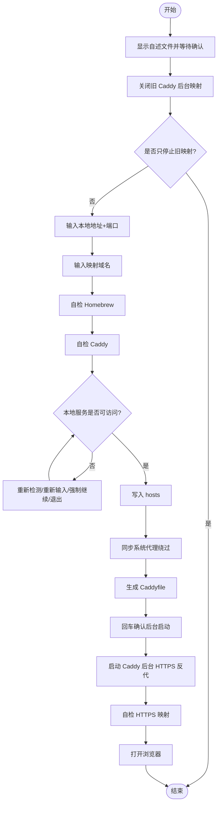

# **MacOS**@[**Caddy**](https://caddyserver.com/)<font color=red>本地域名 HTTPS 映射脚本</font>蓝皮书📘

<p align="left">
  <a></a>
  <a></a>
  <a></a>
  <a></a>
  <a></a>
</p>


<!-- jobs-toc:start -->
<!-- jobs-toc:source {"v":2,"token":"[toc]"} -->
<details>
<summary>📚 目录（点击展开 / 收起）</summary>

- [🔥 前言](#jobs-toc-heading-1)
- [一、🎯 脚本白皮书](#jobs-toc-heading-2)
- [二、🧩 核心能力](#jobs-toc-heading-3)
  - [1、启动保护](#jobs-toc-heading-4)
  - [2、旧映射清理](#jobs-toc-heading-5)
  - [3、Homebrew 自检](#jobs-toc-heading-6)
  - [4、Caddy 自检](#jobs-toc-heading-7)
- [三、🚀 使用方法](#jobs-toc-heading-8)
  - [1、双击运行](#jobs-toc-heading-9)
  - [2、命令行传参](#jobs-toc-heading-10)
  - [3、只停止旧映射](#jobs-toc-heading-11)
- [四、🧪 Stirling-PDF / Vite 场景](#jobs-toc-heading-12)
- [五、🧭 流程图](#jobs-toc-heading-13)
- [六、🔍 常用排查命令](#jobs-toc-heading-14)
  - [1、检查域名解析](#jobs-toc-heading-15)
  - [2、检查 Caddy 监听](#jobs-toc-heading-16)
  - [3、检查 HTTPS 映射](#jobs-toc-heading-17)
  - [4、检查本地服务](#jobs-toc-heading-18)
- [七、⚠️ 注意事项](#jobs-toc-heading-19)
- [八、日志文件](#jobs-toc-heading-20)

</details>
<!-- jobs-toc:end -->

## <span id="jobs-toc-heading-1" data-jobs-toc="v2">🔥 <font id=前言>前言</font></span><!-- jobs-toc:heading-end -->

- 采用 Shell 脚本的原因：Shell 来自 [**macOS**](https://www.apple.com/macos/) 原生系统底层，虽然写法相对繁琐冗杂，但执行效率高，并且不需要额外介入 [**Ruby**](https://www.ruby-lang.org)、[**Python**](https://www.python.org) 等第三方运行环境，因此具备更好的移植性。

> 当前脚本：`【MacOS】Caddy本地域名映射.command`

- 🔧 **工欲善其事必先利其器**
- 🌋 **站在巨人的肩膀上，才能看得更远**
- ✝️ **面向信仰编程**
- 🔔 **温馨提示**：本脚本用于把本机服务映射成 HTTPS 本地域名，例如：

  ```shell
  http://localhost:5173  ➤  https://jobs.pdf.com
  ```

## <span id="jobs-toc-heading-2" data-jobs-toc="v2">一、🎯 脚本白皮书 <a href="#前言" style="font-size:17px; color:green;"><b>🔼</b></a> <a href="#🔚" style="font-size:17px; color:green;"><b>🔽</b></a></span><!-- jobs-toc:heading-end -->

本脚本用于 macOS 本地开发场景，自动完成 Caddy 自检安装、hosts 写入、代理绕过、Caddyfile 生成、HTTPS 证书信任和后台反向代理启动。

它只要求输入两个核心参数：

```shell
本地地址+端口
映射 URL 字符串名
```

示例：

```shell
本地地址+端口：localhost:5173
映射 URL 字符串名：jobs.pdf.com
```

最终访问：

```shell
https://jobs.pdf.com/
```

## <span id="jobs-toc-heading-3" data-jobs-toc="v2">二、🧩 核心能力 <a href="#前言" style="font-size:17px; color:green;"><b>🔼</b></a> <a href="#🔚" style="font-size:17px; color:green;"><b>🔽</b></a></span><!-- jobs-toc:heading-end -->

### <span id="jobs-toc-heading-4" data-jobs-toc="v2">1、启动保护 <a href="#前言" style="font-size:17px; color:green;"><b>🔼</b></a> <a href="#🔚" style="font-size:17px; color:green;"><b>🔽</b></a></span><!-- jobs-toc:heading-end -->

双击脚本后会先显示自述说明，并阻塞等待确认，避免误操作。

### <span id="jobs-toc-heading-5" data-jobs-toc="v2">2、旧映射清理 <a href="#前言" style="font-size:17px; color:green;"><b>🔼</b></a> <a href="#🔚" style="font-size:17px; color:green;"><b>🔽</b></a></span><!-- jobs-toc:heading-end -->

确认自述文件后，脚本第一件事会关闭旧的 Caddy 后台映射，避免历史配置干扰。

如果只是想结束映射，可以再次运行脚本，确认自述文件后，在清理完成提示处输入：

```shell
q
```

即可只关闭旧映射并退出。

### <span id="jobs-toc-heading-6" data-jobs-toc="v2">3、Homebrew 自检 <a href="#前言" style="font-size:17px; color:green;"><b>🔼</b></a> <a href="#🔚" style="font-size:17px; color:green;"><b>🔽</b></a></span><!-- jobs-toc:heading-end -->

- 已有 Homebrew 时保留原有维护交互，不因目录只读而自动另装。
- [**Homebrew**](https://brew.sh/) 安装路径由用户选择：已有可运行安装时复用；确实需要安装时先强提示，只有精确输入大写 `YES` 才选择系统标准目录，其它输入或直接回车选择当前用户的 `.local/homebrew`。`YES` 只表示选择路径，权限与密码由官方安装器实际处理；有管理员权限也可以选用户目录。选定路径失败立即停止，不自动切换；`Ctrl+C` / 输入结束取消整个任务。
- 用户目录安装需要可用 Git 与 curl；后续系统级软件仍可能要求管理员权限。

### <span id="jobs-toc-heading-7" data-jobs-toc="v2">4、Caddy 自检 <a href="#前言" style="font-size:17px; color:green;"><b>🔼</b></a> <a href="#🔚" style="font-size:17px; color:green;"><b>🔽</b></a></span><!-- jobs-toc:heading-end -->

脚本会自动检测 Caddy：

- 未安装：通过 Homebrew 安装
- 已安装：询问是否升级

升级逻辑同样是：

```shell
直接按 [Enter]：跳过升级
输入任意字符后回车：执行升级
```

## <span id="jobs-toc-heading-8" data-jobs-toc="v2">三、🚀 使用方法 <a href="#前言" style="font-size:17px; color:green;"><b>🔼</b></a> <a href="#🔚" style="font-size:17px; color:green;"><b>🔽</b></a></span><!-- jobs-toc:heading-end -->

### <span id="jobs-toc-heading-9" data-jobs-toc="v2">1、双击运行 <a href="#前言" style="font-size:17px; color:green;"><b>🔼</b></a> <a href="#🔚" style="font-size:17px; color:green;"><b>🔽</b></a></span><!-- jobs-toc:heading-end -->

双击：

```shell
【MacOS】Caddy本地域名映射.command
```

按提示输入：

```shell
本地地址+端口：localhost:5173
映射 URL 字符串名：jobs.pdf.com
```

### <span id="jobs-toc-heading-10" data-jobs-toc="v2">2、命令行传参 <a href="#前言" style="font-size:17px; color:green;"><b>🔼</b></a> <a href="#🔚" style="font-size:17px; color:green;"><b>🔽</b></a></span><!-- jobs-toc:heading-end -->

```shell
"<path-to>/【MacOS】Caddy本地域名映射.command" "localhost:5173" "jobs.pdf.com"
```

### <span id="jobs-toc-heading-11" data-jobs-toc="v2">3、只停止旧映射 <a href="#前言" style="font-size:17px; color:green;"><b>🔼</b></a> <a href="#🔚" style="font-size:17px; color:green;"><b>🔽</b></a></span><!-- jobs-toc:heading-end -->

```shell
"<path-to>/【MacOS】Caddy本地域名映射.command" --stop
```

或者双击运行脚本，确认自述文件后，在旧映射清理完成提示处输入：

```shell
q
```

## <span id="jobs-toc-heading-12" data-jobs-toc="v2">四、🧪 Stirling-PDF / Vite 场景 <a href="#前言" style="font-size:17px; color:green;"><b>🔼</b></a> <a href="#🔚" style="font-size:17px; color:green;"><b>🔽</b></a></span><!-- jobs-toc:heading-end -->

如果目标服务是 Vite，建议启动服务时仍显式加入 allowed host：

```shell
cd ../../../Stirling-PDF
__VITE_ADDITIONAL_SERVER_ALLOWED_HOSTS=jobs.pdf.com task frontend:dev
```

然后运行本脚本：

```shell
本地地址+端口：http://localhost:5173
映射 URL 字符串名：jobs.pdf.com
```

脚本会把 `localhost` 自动规整为 `127.0.0.1`，避免 Caddy 优先访问 `::1` 导致 502。

## <span id="jobs-toc-heading-13" data-jobs-toc="v2">五、🧭 流程图 <a href="#前言" style="font-size:17px; color:green;"><b>🔼</b></a> <a href="#🔚" style="font-size:17px; color:green;"><b>🔽</b></a></span><!-- jobs-toc:heading-end -->



## <span id="jobs-toc-heading-14" data-jobs-toc="v2">六、🔍 常用排查命令 <a href="#前言" style="font-size:17px; color:green;"><b>🔼</b></a> <a href="#🔚" style="font-size:17px; color:green;"><b>🔽</b></a></span><!-- jobs-toc:heading-end -->

### <span id="jobs-toc-heading-15" data-jobs-toc="v2">1、检查域名解析 <a href="#前言" style="font-size:17px; color:green;"><b>🔼</b></a> <a href="#🔚" style="font-size:17px; color:green;"><b>🔽</b></a></span><!-- jobs-toc:heading-end -->

```shell
dscacheutil -q host -a name jobs.pdf.com
```

期望看到：

```shell
ip_address: 127.0.0.1
```

### <span id="jobs-toc-heading-16" data-jobs-toc="v2">2、检查 Caddy 监听 <a href="#前言" style="font-size:17px; color:green;"><b>🔼</b></a> <a href="#🔚" style="font-size:17px; color:green;"><b>🔽</b></a></span><!-- jobs-toc:heading-end -->

```shell
sudo lsof -nP -iTCP:443 -sTCP:LISTEN
```

期望看到：

```shell
caddy ... TCP *:443 (LISTEN)
```

### <span id="jobs-toc-heading-17" data-jobs-toc="v2">3、检查 HTTPS 映射 <a href="#前言" style="font-size:17px; color:green;"><b>🔼</b></a> <a href="#🔚" style="font-size:17px; color:green;"><b>🔽</b></a></span><!-- jobs-toc:heading-end -->

```shell
curl -vk https://jobs.pdf.com/
```

### <span id="jobs-toc-heading-18" data-jobs-toc="v2">4、检查本地服务 <a href="#前言" style="font-size:17px; color:green;"><b>🔼</b></a> <a href="#🔚" style="font-size:17px; color:green;"><b>🔽</b></a></span><!-- jobs-toc:heading-end -->

```shell
curl -I http://127.0.0.1:5173/
```

如果这里不通，Caddy 映射必然会 502。

## <span id="jobs-toc-heading-19" data-jobs-toc="v2">七、⚠️ 注意事项 <a href="#前言" style="font-size:17px; color:green;"><b>🔼</b></a> <a href="#🔚" style="font-size:17px; color:green;"><b>🔽</b></a></span><!-- jobs-toc:heading-end -->

- Caddy 只负责映射，不负责启动你的本地项目。
- 本地服务必须先启动，脚本才会继续创建映射。
- 如果使用 `.com`，必须依赖 `$SYSTEM_CONFIG_DIR/hosts` 指向本机。
- 如果浏览器走系统代理，脚本会自动把映射域名加入代理绕过列表。
- 如果目标服务是 Vite，仍建议显式设置 allowed host。
- Caddy 启动后是后台服务，关闭终端不会影响映射。

## <span id="jobs-toc-heading-20" data-jobs-toc="v2">八、日志文件 <a href="#前言" style="font-size:17px; color:green;"><b>🔼</b></a> <a href="#🔚" style="font-size:17px; color:green;"><b>🔽</b></a></span><!-- jobs-toc:heading-end -->

运行日志默认写入 `$TMPDIR`，文件名通常来自脚本名去掉扩展名：

```shell
$TMPDIR/【MacOS】Caddy本地域名映射.log
```

<a id="🔚" href="#前言" style="font-size:17px; color:green; font-weight:bold;">我是有底线的➤点我回到首页</a>
