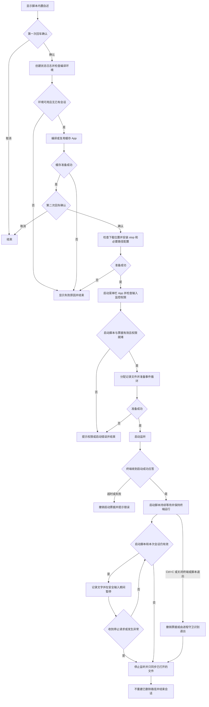

# `JobsKeyboardRecorder.command` 键盘输入记录


<!-- jobs-toc:start -->
<!-- jobs-toc:source {"v":2,"token":"[toc]"} -->
<details>
<summary>📚 目录（点击展开 / 收起）</summary>

- [🔥 前言](#%E5%89%8D%E8%A8%80)
- [一、功能与边界](#capabilities)
- [二、环境与运行方式](#requirements)
  - [2.1、环境要求](#jobs-toc-heading-4)
  - [2.2、目录与启动命令](#jobs-toc-heading-5)
- [三、启动确认与权限](#startup)
  - [3.1、两次回车各自负责什么](#jobs-toc-heading-7)
  - [3.2、授权给哪个 App](#jobs-toc-heading-8)
- [四、状态与停止](#stop)
- [五、记录文件与编号](#records)
  - [5.1、首次与后续记录](#jobs-toc-heading-11)
  - [5.2、已有内容与写入保护](#jobs-toc-heading-12)
- [六、写入范围与日志](#files-and-logs)
- [七、执行流程](#flow)
- [八、常见问题与清理](#faq)
- [九、验证说明](#verification)

</details>
<!-- jobs-toc:end -->

---

## 🔥 <span id="前言">前言</span>

`JobsKeyboardRecorder.command` 用于记录当前登录会话中、按键事件携带的可见文字。入口使用系统自带的 [**zsh**](https://www.zsh.org/)，内嵌 [**Objective-C**](https://developer.apple.com/library/archive/documentation/Cocoa/Conceptual/ProgrammingWithObjectiveC/Introduction/Introduction.html) 源码，运行时在本机编译为 [**macOS**](https://www.apple.com/macos/) 原生菜单栏 App。当前内嵌程序版本为 `1.7.0`。

启动需要两次回车确认及手动授予输入监控权限。终端出现 **“记录器已成功启动，请保持此终端运行”** 后，启动脚本会持续等待本次会话。**只有程序主动运行期间才允许创建或重建下载目录中的 `JobsKeyboardRecorder`；关闭启动终端、按 `Ctrl+C`，或启动脚本正常、异常退出后，记录随之停止。**

| 操作 | 执行方式 | 完成标志 |
| --- | --- | --- |
| 开启 | 双击同目录的 `JobsKeyboardRecorder.command`，按提示回车两次，并保持该终端运行 | 终端显示“记录器已成功启动，请保持此终端运行” |
| 在启动终端停止 | 按 `Ctrl+C`，或关闭启动终端 | 记录停止，菜单栏记录状态消失 |
| 从菜单或其它终端停止 | 菜单栏选择“停止并保存”，或另开终端输入 `stop` 后回车 | `stop` 显示“■ 已停止并保存。”；启动脚本随后结束 |

记录是本地 UTF-8 纯文本，可能包含其它应用中的私人文字。仅在有权记录的会话中使用；它保存输入过程中的字符，不负责恢复编辑后的最终文稿。

- [功能与边界](#capabilities)
- [环境与运行方式](#requirements)
- [启动确认与权限](#startup)
- [状态与停止](#stop)
- [记录文件与编号](#records)
- [写入范围与日志](#files-and-logs)
- [执行流程](#flow)
- [常见问题与清理](#faq)
- [验证说明](#verification)

## 一、<span id="capabilities">功能与边界</span> <a href="#前言" style="font-size:17px; color:green;"><b>🔼</b></a> <a href="#🔚" style="font-size:17px; color:green;"><b>🔽</b></a>

| 项目 | 实际行为 |
| --- | --- |
| 记录范围 | 当前登录会话中可被系统事件监听接口观察到的键盘文字，不限于启动脚本的终端 |
| 文字格式 | 仅保存按下事件中的可见字符；保留空格、换行和制表符，回车统一为换行 |
| 忽略事件 | 松开事件、单独修饰键、非文字控制字符，以及带 `Command` / `Control` 的组合键 |
| 长按按键 | 系统产生的重复按下事件可能继续写入，不额外去重 |
| 输入法与编辑 | 不还原输入法最终上屏文字、粘贴内容、光标移动、退格或删除后的最终结果 |
| 安全输入 | 检测到系统安全输入状态后暂停，状态结束后恢复；依赖系统实际启用该保护，不能保证所有敏感文字都被排除 |
| 运行界面 | 菜单栏 App，无普通窗口；启动脚本持续在前台等待，记录期间保持启动终端运行 |
| 会话边界 | 原生程序绑定启动脚本；脚本退出、启动票据失效或收到停止请求后，不再记录或重建记录路径 |
| 数据与启动 | 不上传网络、不读取剪贴板或应用文稿、不设置开机或登录自动启动 |
| 异常处理 | 写入失败、权限撤销或监听被关闭时停止；监听超时会提示可能缺少事件并尝试恢复 |

纯文本正文不附加时间戳、键码或结构化字段。会话时间、状态和事件计数放在[独立状态日志](#files-and-logs)中。

## 二、<span id="requirements">环境与运行方式</span> <a href="#前言" style="font-size:17px; color:green;"><b>🔼</b></a> <a href="#🔚" style="font-size:17px; color:green;"><b>🔽</b></a>

### <span id="jobs-toc-heading-4" data-jobs-toc="v2">2.1、环境要求 <a href="#前言" style="font-size:17px; color:green;"><b>🔼</b></a> <a href="#🔚" style="font-size:17px; color:green;"><b>🔽</b></a></span><!-- jobs-toc:heading-end -->

- 源码和 App 声明的最低系统为 macOS `10.15`，以当前登录的普通用户运行，不使用 `sudo`。
- 需要可交互的终端。无参数启动时，标准输入和输出都必须连接终端；不支持通过管道自动确认。记录期间保持启动终端和脚本运行。
- 需要可用的 [**Apple Command Line Tools**](https://developer.apple.com/documentation/xcode/installing-the-command-line-tools)、`xcrun`、`clang` 和 macOS SDK。**每次启动都会检查编译环境，即使已有可复用缓存也需要这些工具。**
- 脚本不自动安装或升级工具，不下载第三方源码；检查失败后停止，并在终端说明原因。
- 当前用户的下载目录、缓存目录和系统临时目录必须可写；同名记录位置不能是符号链接或异常归属对象。

只读环境检查命令：

```shell
xcode-select -p
xcrun --sdk macosx --find clang
xcrun --sdk macosx --show-sdk-path
```

缺少命令行工具时，可自行运行以下命令，再按照系统提示完成安装：

```shell
xcode-select --install
```

### <span id="jobs-toc-heading-5" data-jobs-toc="v2">2.2、目录与启动命令 <a href="#前言" style="font-size:17px; color:green;"><b>🔼</b></a> <a href="#🔚" style="font-size:17px; color:green;"><b>🔽</b></a></span><!-- jobs-toc:heading-end -->

```text
【MacOS】JobsKeyboardRecorder.command/
├── JobsKeyboardRecorder.command
└── README.md
```

双击目录内的 [主脚本](./JobsKeyboardRecorder.command)，或在本 README 所在目录运行：

```shell
/bin/zsh ./JobsKeyboardRecorder.command
```

对外仅提供两个入口：无参数启动，以及 `stop` 停止。没有 `--help`、`--version`、`--self-test` 或卸载参数；源码中原生辅助程序的内部接口不属于 `.command` 使用参数。

## 三、<span id="startup">启动确认与权限</span> <a href="#前言" style="font-size:17px; color:green;"><b>🔼</b></a> <a href="#🔚" style="font-size:17px; color:green;"><b>🔽</b></a>

### <span id="jobs-toc-heading-7" data-jobs-toc="v2">3.1、两次回车各自负责什么 <a href="#前言" style="font-size:17px; color:green;"><b>🔼</b></a> <a href="#🔚" style="font-size:17px; color:green;"><b>🔽</b></a></span><!-- jobs-toc:heading-end -->

| 阶段 | 操作 | 已发生的影响 |
| --- | --- | --- |
| 展示自述 | 回车准备；非空输入取消，也可 `Ctrl+C` 终止 | 确认前不创建日志、不编译、不监听 |
| 准备程序 | 检查环境，编译或复用原生 App | 已创建临时状态日志和缓存；尚未监听 |
| 再次确认 | 回车同意开始；非空输入取消，也可 `Ctrl+C` 终止 | 取消不会撤销此前生成的日志和缓存 |
| 启动 App | 准备下载位置、安装停止命令、按需补充命令路径，再检查权限 | 即使随后授权失败，已安装的 `stop` 和配置变动仍可能保留 |
| 确认就绪 | 等待原生 App 的启动应答，约 `15` 秒内确认 | 成功后显示菜单栏记录状态，启动脚本持续等待；关闭该终端会停止记录 |

源码未变且缓存 App 校验通过时复用原生程序；源码变化或缓存失效时重新编译并本地签名。缓存 App 和缓存源码会更新，不保留旧版本备份。

### <span id="jobs-toc-heading-8" data-jobs-toc="v2">3.2、授权给哪个 App <a href="#前言" style="font-size:17px; color:green;"><b>🔼</b></a> <a href="#🔚" style="font-size:17px; color:green;"><b>🔽</b></a></span><!-- jobs-toc:heading-end -->

授权对象是当前用户 `Library/Caches` 中 `JobsKeyboardRecorder` 目录内的 **`JobsKeyboardRecorder.app`**，不是 `.command` 文本文件。授权失败时，脚本自动请求打开输入监控页面，并在支持颜色的交互终端中将“需要授权的 App”整行标红加粗；非彩色终端与状态日志保持纯文本。

1、缺少权限时，脚本请求打开“系统设置 → 隐私与安全性 → 输入监控”。旧版系统从相应的隐私设置进入输入监控。该权限允许观察其它应用中的输入，系统入口参见 [**Apple 输入监控说明**](https://support.apple.com/guide/mac-help/control-access-to-input-monitoring-on-mac-mchl4cedafb6/mac)。

2、在输入监控列表中添加终端显示的 App 并开启权限。可在文件选择窗口使用“前往文件夹”，粘贴终端给出的实际路径。

3、授权后重新运行主脚本并完成两次确认。授权窗口出现或终端显示“进程已完成”，都不代表已经开始记录。

4、更新编译后的 App 如仍无法取得权限，先从输入监控列表移除旧项，再添加当前缓存 App、开启权限并重新运行。

保存记录不需要管理员密码；系统权限界面如要求身份验证，由系统自行处理。

## 四、<span id="stop">状态与停止</span> <a href="#前言" style="font-size:17px; color:green;"><b>🔼</b></a> <a href="#🔚" style="font-size:17px; color:green;"><b>🔽</b></a>

| 菜单栏文字 | 含义 |
| --- | --- |
| `键盘记录准备中` | App 正在准备，尚不能据此认定启动成功 |
| `● 键盘记录中` | 正在观察并保存有效文字事件 |
| `⏸ 键盘记录暂停` | 系统启用安全输入，暂停记录；安全输入结束后自动恢复 |

**记录期间保持启动终端运行。** 在该终端按 `Ctrl+C` 或直接关闭它，都会结束记录；启动脚本正常或异常退出时，原生程序也会停止。

也可点击菜单栏状态，选择 **“停止并保存”**，或另开 zsh 终端输入：

```shell
stop
```

等待终端显示以下确认，表示记录已停止且保存完成：

```text
■ 已停止并保存。
```

若当前终端尚未加载新增命令路径，或使用其它 Shell，可在本 README 所在目录直接运行：

```shell
/bin/zsh ./JobsKeyboardRecorder.command stop
```

停止入口不编译、不申请输入监控权限，也不会开启新的记录；它通过本地控制通道请求停止，并等待保存确认，等待上限约 `8` 秒。出现“未收到停止并保存成功的确认”时，应检查状态日志和菜单栏，不能按已保存处理。没有运行会话时，停止命令可正常返回。

启动脚本通过退出清理撤销本次启动票据；即使脚本被强制结束、来不及执行清理，原生程序也会核对发起进程是否仍有效。守卫同时检查进程 PID、启动时间、当前用户和启动票据，并在每次处理事件、创建输出路径前及约每 `0.25` 秒的计时器中执行。遗留票据或被复用的 PID 不能让旧会话继续记录。

停止时只同步并关闭已打开的文件句柄，不重新打开或重建被删除的记录路径。注销或重启后不会自动再次启动；已有历史记录、缓存和 `stop` 命令保留。

## 五、<span id="records">记录文件与编号</span> <a href="#前言" style="font-size:17px; color:green;"><b>🔼</b></a> <a href="#🔚" style="font-size:17px; color:green;"><b>🔽</b></a>

固定保存到当前用户的 **下载目录（`Downloads`）**，不是文稿目录，也不在脚本旁边。入口没有自定义输出目录参数。

### <span id="jobs-toc-heading-11" data-jobs-toc="v2">5.1、首次与后续记录 <a href="#前言" style="font-size:17px; color:green;"><b>🔼</b></a> <a href="#🔚" style="font-size:17px; color:green;"><b>🔽</b></a></span><!-- jobs-toc:heading-end -->

首次记录使用一个无后缀的普通文件：

```text
下载目录/
└── JobsKeyboardRecorder        ← 第一份记录，普通文件
```

第二次开始新会话时，将原文件迁入同名目录，保留为 `0`，新会话写入 `1`：

```text
下载目录/
└── JobsKeyboardRecorder/       ← 此时为目录
    ├── 0                      ← 第一份记录
    └── 1                      ← 第二份记录
```

以后每次新会话使用已有最大编号加一，例如继续创建 `2`、`3`；不回填删除后留下的编号空缺。已有同名空目录会恢复为首次单文件模式。没有输入有效文字时，记录文件可能为空。

正文可用文本编辑器打开。目录和编号区分会话，正文没有时间标签，也不会把多次会话合并到同一个编号中。

### <span id="jobs-toc-heading-12" data-jobs-toc="v2">5.2、已有内容与写入保护 <a href="#前言" style="font-size:17px; color:green;"><b>🔼</b></a> <a href="#🔚" style="font-size:17px; color:green;"><b>🔽</b></a></span><!-- jobs-toc:heading-end -->

- 新会话创建文件时不覆盖已有目标；同一会话向当前记录追加。已有其它会话正在运行时，会拒绝重复启动。
- 已存在、归当前用户且权限为 `600` 的同名普通文件会被当作首份记录迁入 `0`，不会检查正文格式。**不要把无关文件放在这个固定名称下。**
- 对旧版编号 `.jsonl` 文件去除后缀，对 `keyboard-*.jsonl` 记录改用递增编号。仅调整文件名，**不转换历史正文格式**；同名目标冲突时停止，不覆盖原目标。
- 完全没有可识别记录的非空同名目录会被拒绝。目录内已有可识别记录时，其它条目可能保留；不要将该目录用于存放无关资料。
- 仅在启动脚本和本次会话仍有效时，原生记录器才会在写入前检查路径；记录或状态文件、父目录缺失时，尝试重建后继续追加。这不代表能够恢复已删除的旧正文。会话结束后不再因键盘输入重建 `JobsKeyboardRecorder`，停止收尾也不重建已删除的输出路径。清理文件前应先[停止记录](#stop)。
- 文件类型、所有权或链接检查异常，以及磁盘空间、权限等写入错误，会阻断启动或停止当前记录。历史迁移途中失败时，已完成的改名可能保留，应先核对现场再重试。

## 六、<span id="files-and-logs">写入范围与日志</span> <a href="#前言" style="font-size:17px; color:green;"><b>🔼</b></a> <a href="#🔚" style="font-size:17px; color:green;"><b>🔽</b></a>

以下位置均由脚本按当前用户环境解析，不依赖仓库的克隆位置。

| 文件或位置 | 用途与影响 |
| --- | --- |
| 下载目录中的 `JobsKeyboardRecorder` | 按键正文；首次为单文件，后续为编号目录；仅主动运行的有效会话可以创建或重建 |
| 当前用户 `Library/Caches` 中的 `JobsKeyboardRecorder` 目录 | 保存原生 App、缓存源码、本地控制 socket 和构建临时目录 |
| 当前用户 `.local/bin` 中的 `stop` | 安装停止命令；只更新带本脚本标记的入口，遇到其它同名命令或文件时拒绝覆盖 |
| zsh 配置目录中的 `.zshrc` | 命令目录不在当前 `PATH` 且标记块不存在时追加路径配置；设置了 `ZDOTDIR` 时使用该配置目录，否则使用当前用户主目录 |
| 配置旁的 `.zshrc.keyboard-recorder.时间戳.bak` | 已有 `.zshrc` 在实际追加前备份；原配置文件不存在时直接创建，不生成旧文件备份 |
| 系统临时目录中的 `JobsKeyboardRecorder.随机六位字符` | 首次确认后或使用 `stop` 参数时创建的独立状态日志；不是固定的 `JobsKeyboardRecorder.log` |

状态日志的实际完整路径会在编译环境检查通过后打印。若编译器或 SDK 的早期检查失败，路径可能尚未打印，可在系统临时目录按上述文件名前缀查找。日志记录环境检查、编译输出、记录路径、暂停/恢复、停止原因及文字输入事件计数；运行期间约每 `30` 秒更新一次计数，**不混入按键正文**。停止命令的结果同时在调用它的终端显示。

缓存目录、记录目录使用 `700`，正文和状态日志使用 `600`；已有下载目录不会整体改为 `700`。这些是本地访问权限，正文没有加密，不能将权限限制理解为对管理员或已获权限程序的绝对隔离。

## 七、<span id="flow">执行流程</span> <a href="#前言" style="font-size:17px; color:green;"><b>🔼</b></a> <a href="#🔚" style="font-size:17px; color:green;"><b>🔽</b></a>

以下 [**Mermaid**](https://mermaid.js.org) 图对应无参数启动入口；`stop` 参数在日志初始化后直接分流至停止控制，不进入编译或记录准备。



## 八、<span id="faq">常见问题与清理</span> <a href="#前言" style="font-size:17px; color:green;"><b>🔼</b></a> <a href="#🔚" style="font-size:17px; color:green;"><b>🔽</b></a>

| 问题 | 排查与处理 |
| --- | --- |
| 双击不能执行 | 确认打开的是目录内的主脚本；可改用本目录的 `/bin/zsh ./JobsKeyboardRecorder.command`，再按终端提示排查 |
| 提示找不到 `clang` 或 SDK | 先执行[只读环境检查](#requirements)，按需安装或修复命令行工具，再重新运行 |
| 已开启输入监控仍启动失败 | 按终端完整路径确认授权的是当前缓存 App；更新后尝试移除旧项、重新添加，再重新启动脚本 |
| 终端显示“进程已完成”但没有记录 | 该文字不代表成功；检查脚本是否明确打印“记录器已成功启动”，再查看状态日志 |
| `stop: command not found` | 打开新的 zsh 终端，或从脚本目录运行 `/bin/zsh ./JobsKeyboardRecorder.command stop` |
| 提示已有同名 `stop` | 脚本不会覆盖其它工具；先核对冲突来源，不能直接删除来源不明的命令 |
| 没有输入或部分文字缺失 | 查看是否处于安全输入暂停；输入法、粘贴、快捷键和文稿编辑不保证可还原，监听超时也可能产生缺口 |
| 找不到记录文件 | 到当前用户下载目录查看 `JobsKeyboardRecorder`；首次是文件，第二次起为目录，实际新记录路径也会写入状态日志 |
| 关闭启动终端后还会记录吗 | `1.7.0` 会停止；只有启动脚本仍运行且会话有效时才可记录。启动脚本被强制结束时，原生进程守卫同样会识别退出 |
| 没运行脚本，输入时却又生成记录 | 先另开终端执行 `stop`，停止可能残留的旧版会话，再重新运行当前脚本；当前版本把记录资格绑定到仍在运行的启动脚本 |
| 删除记录后又出现 | 有效会话运行期间，后续写入会尝试重建；先停止再删除。停止后继续键盘输入或执行停止收尾，都不会重建该记录路径 |
| 提示路径、归属或权限异常 | 核对目标是否被替换成链接、其它类型或其它用户文件；先保留现场和已有记录，不盲目递归修改权限 |

脚本没有自动卸载入口。需要清理时，按以下顺序手动处理：

1、先在启动终端按 `Ctrl+C`、关闭该终端，或使用 `stop` / 菜单栏“停止并保存”，确认会话结束。

2、备份所需记录，再按需删除下载目录中的记录及系统临时目录中的状态日志。记录没有自动保留期限或按大小滚动清理。

3、移除当前用户缓存中的 `JobsKeyboardRecorder` 目录；在输入监控设置中移除对应 App 授权。

4、核对当前用户 `.local/bin` 中的 `stop` 确实带有 `# JobsKeyboardRecorder stop command` 标记，再按需删除该入口。

5、核对 `.zshrc` 中以 `JobsKeyboardRecorder stop PATH` 标记的配置块。只有其它工具不依赖该路径配置时才移除；不要直接用旧备份覆盖后来新增的配置。

## 九、<span id="verification">验证说明</span> <a href="#前言" style="font-size:17px; color:green;"><b>🔼</b></a> <a href="#🔚" style="font-size:17px; color:green;"><b>🔽</b></a>

本文根据同目录脚本的实际控制流程、内嵌源码与路径规则编写。可在本目录进行不会启动记录的 Shell 语法检查：

```shell
/bin/zsh -n ./JobsKeyboardRecorder.command
```

已完成 `zsh -n` 语法检查，并在临时目录中提取内嵌原生源码，以 `-Wall -Wextra -Werror` 编译通过。

隔离验证已通过 `16` 项原生模拟会话回归、`13` 项 Shell 生命周期回归和 `21` 项写入口检查，覆盖正常停止、票据撤销、进程强制退出、真实伪终端中的 `Ctrl+C` / 关闭终端、启动失败与超时清理，以及停止后不重建已删除路径。命令替换与子 Shell 不会提前清理会话，真正退出时才执行清理。

验证不启动真实键盘监听、不读取真实键盘记录、不安装停止命令、不修改终端配置，也不触发系统授权。不同系统和机器上的授权及实际录制效果仍需在目标环境中验证。流程图已核对节点与内部链接，尚未进行渲染预览。

<a id="🔚" href="#前言" style="font-size:17px; color:green; font-weight:bold;">我是有底线的➤点我回到首页</a>
