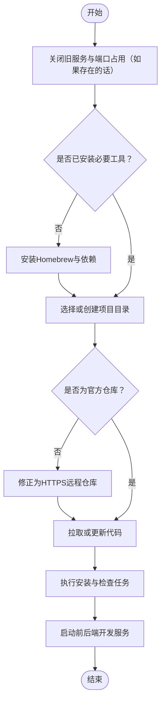
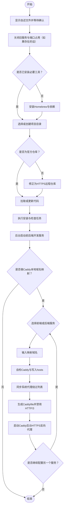

# **MacOS** [**Stirling-PDF**](https://www.stirling.com)本地部署+[**Caddy**](https://caddyserver.com)本地端口域名映射

<p align="left">
  <a href="https://www.stirling.com"></a>
  <a href="https://caddyserver.com"></a>
  <a href="https://brew.sh/"></a>
  <a></a>
  <a></a>
  <a></a>
</p>


<!-- jobs-toc:start -->
<!-- jobs-toc:source {"v":2,"token":"[toc]"} -->
<details>
<summary>📚 目录（点击展开 / 收起）</summary>

- [🔥 前言](#jobs-toc-heading-1)
- [一、🎯 项目白皮书](#jobs-toc-heading-2)
- [二、🧭 脚本执行流程](#jobs-toc-heading-3)
- [三、🧩 功能清单](#jobs-toc-heading-4)
  - [1、启动前置说明](#jobs-toc-heading-5)
  - [2、旧服务清理](#jobs-toc-heading-6)
  - [3、开发环境自检](#jobs-toc-heading-7)
  - [4、统一升级交互规范](#jobs-toc-heading-8)
  - [5、源码目录选择](#jobs-toc-heading-9)
  - [6、官方仓库校验](#jobs-toc-heading-10)
  - [7、安装与检查任务](#jobs-toc-heading-11)
  - [8、前后端开发服务](#jobs-toc-heading-12)
- [四、🌐 Caddy 本地域名映射](#jobs-toc-heading-13)
  - [1、映射入口](#jobs-toc-heading-14)
  - [2、域名输入](#jobs-toc-heading-15)
  - [3、hosts 写入](#jobs-toc-heading-16)
  - [4、系统代理绕过](#jobs-toc-heading-17)
  - [5、Caddy 反向代理](#jobs-toc-heading-18)
  - [6、后台运行](#jobs-toc-heading-19)
- [五、🧪 常用自检命令](#jobs-toc-heading-20)
  - [1、检查前端服务](#jobs-toc-heading-21)
  - [2、检查后端服务](#jobs-toc-heading-22)
  - [3、检查域名解析](#jobs-toc-heading-23)
  - [4、检查 Caddy](#jobs-toc-heading-24)
  - [5、检查 HTTPS 映射](#jobs-toc-heading-25)
- [六、⚠️ 常见问题](#jobs-toc-heading-26)
  - [1、浏览器显示 502](#jobs-toc-heading-27)
  - [2、浏览器提示 Host 不允许](#jobs-toc-heading-28)
  - [3、Chrome 报 SSL 协议错误](#jobs-toc-heading-29)
  - [4、443 端口被占用](#jobs-toc-heading-30)
  - [5、关闭终端后还能访问吗？](#jobs-toc-heading-31)
- [七、🧹 停止与清理](#jobs-toc-heading-32)
  - [1、停止本地服务](#jobs-toc-heading-33)
  - [2、手动停止 Caddy](#jobs-toc-heading-34)
  - [3、查看日志](#jobs-toc-heading-35)
- [八、✅ 总结](#jobs-toc-heading-36)

</details>
<!-- jobs-toc:end -->

## <span id="jobs-toc-heading-1" data-jobs-toc="v2">🔥 <font id=前言>前言</font></span><!-- jobs-toc:heading-end -->

- 采用 Shell 脚本的原因：Shell 来自 [**macOS**](https://www.apple.com/macos/) 原生系统底层，虽然写法相对繁琐冗杂，但执行效率高，并且不需要额外介入 [**Ruby**](https://www.ruby-lang.org)、[**Python**](https://www.python.org) 等第三方运行环境，因此具备更好的移植性。

> 当前总行数：

- 🔧 **工欲善其事必先利其器**

- 🌋 **站在巨人的肩膀上，才能看得更远**

- ✝️ **面向信仰编程**

- 📚 **参考来源**：[**Stirling-PDF**](https://www.stirling.com)｜[**Caddy**](https://caddyserver.com)｜[**Homebrew**](https://brew.sh/)

- 🔔 **温馨提示**：本文较长，直接访问 [**Github**](https://github.com/) 可能无法完整阅读全文

  * 推荐下载到本地阅读，推荐阅读器 ➤ [**Typora**](https://typora.io/)

  * 或者使用 [**Google Chrom**e](https://www.google.com/chrome/) 浏览器安装 `Markdown Preview Plus` 插件并启用

- 本脚本用于在 macOS 上自动完成 [**Stirling-PDF**](https://www.stirling.com) 本地开发部署，并在服务启动完成后，可选接入 [**Caddy**](https://caddyserver.com) 本地域名 HTTPS 映射。

- [**Caddy**](https://caddyserver.com) 映射启动后会在后台运行，关闭终端窗口不会影响映射继续生效。若需要结束映射，可重新运行脚本；脚本在用户确认自述文件后，会优先关闭旧的后台映射。

## <span id="jobs-toc-heading-2" data-jobs-toc="v2">一、🎯 项目白皮书 <a href="#前言" style="font-size:17px; color:green;"><b>🔼</b></a> <a href="#🔚" style="font-size:17px; color:green;"><b>🔽</b></a></span><!-- jobs-toc:heading-end -->

这个脚本解决的是完整的本地部署与本地域名访问链路：

- 自动准备 macOS 开发依赖
- 自动选择、创建或复用 [**Stirling-PDF**](https://www.stirling.com) 本地仓库
- 自动校验官方仓库来源
- 自动修正远程仓库地址为 HTTPS
- 自动拉取或更新代码
- 自动执行安装与检查任务
- 自动后台启动前端与后端开发服务
- 可选使用 [**Caddy**](https://caddyserver.com) 把本地端口映射成本地域名 HTTPS 访问地址

最终本地服务默认如下：

| 服务 | 默认地址 | 说明 |
| --- | --- | --- |
| 前端 | `http://localhost:5173` | 浏览器主入口 |
| 后端 | `http://localhost:8080` | API 服务入口 |
| 域名映射 | `https://你的域名` | 由 [**Caddy**](https://caddyserver.com) 反向代理到本地端口 |

## <span id="jobs-toc-heading-3" data-jobs-toc="v2">二、🧭 脚本执行流程 <a href="#前言" style="font-size:17px; color:green;"><b>🔼</b></a> <a href="#🔚" style="font-size:17px; color:green;"><b>🔽</b></a></span><!-- jobs-toc:heading-end -->

基础部署主流程如下：



这个流程图作为 [**Stirling-PDF**](https://www.stirling.com) 本地部署主干是正确的。融合 [**Caddy**](https://caddyserver.com) 后，脚本在 `启动前后端开发服务` 之后增加了可选的本地域名映射流程：



## <span id="jobs-toc-heading-4" data-jobs-toc="v2">三、🧩 功能清单 <a href="#前言" style="font-size:17px; color:green;"><b>🔼</b></a> <a href="#🔚" style="font-size:17px; color:green;"><b>🔽</b></a></span><!-- jobs-toc:heading-end -->

### <span id="jobs-toc-heading-5" data-jobs-toc="v2">1、启动前置说明 <a href="#前言" style="font-size:17px; color:green;"><b>🔼</b></a> <a href="#🔚" style="font-size:17px; color:green;"><b>🔽</b></a></span><!-- jobs-toc:heading-end -->

脚本双击运行后，会先显示完整自述文件，并等待用户按回车确认。这样可以避免误触后直接修改系统环境、端口占用或后台服务。

### <span id="jobs-toc-heading-6" data-jobs-toc="v2">2、旧服务清理 <a href="#前言" style="font-size:17px; color:green;"><b>🔼</b></a> <a href="#🔚" style="font-size:17px; color:green;"><b>🔽</b></a></span><!-- jobs-toc:heading-end -->

脚本会主动清理旧的 [**Stirling-PDF**](https://www.stirling.com) 后台服务、前端端口、后端端口，以及旧的 [**Caddy**](https://caddyserver.com) 后台映射，避免历史进程影响本次启动。

### <span id="jobs-toc-heading-7" data-jobs-toc="v2">3、开发环境自检 <a href="#前言" style="font-size:17px; color:green;"><b>🔼</b></a> <a href="#🔚" style="font-size:17px; color:green;"><b>🔽</b></a></span><!-- jobs-toc:heading-end -->

脚本会自检：

- <font Color=red>**X**</font>code <font Color=blue>**C**</font>ommand Line <font Color=green>**T**</font>ools
- `git`
- `clang`
- `make`
- [**Homebrew**](https://brew.sh/)
- `node`
- `jenv`
- `openjdk@21`
- `uv`
- `go-task`
- [**Caddy**](https://caddyserver.com)

其中 [**Homebrew**](https://brew.sh/) 未安装时会按芯片架构自动安装；已安装时会询问是否升级。

### <span id="jobs-toc-heading-8" data-jobs-toc="v2">4、统一升级交互规范 <a href="#前言" style="font-size:17px; color:green;"><b>🔼</b></a> <a href="#🔚" style="font-size:17px; color:green;"><b>🔽</b></a></span><!-- jobs-toc:heading-end -->

所有升级类操作统一使用以下规则：

```text
直接按 [Enter]：跳过升级
输入任意字符后回车：执行升级
```

这个规则适用于 [**Homebrew**](https://brew.sh/)、`node`、`jenv`、`openjdk@21`、`uv`、`go-task`、[**Caddy**](https://caddyserver.com) 等依赖。

### <span id="jobs-toc-heading-9" data-jobs-toc="v2">5、源码目录选择 <a href="#前言" style="font-size:17px; color:green;"><b>🔼</b></a> <a href="#🔚" style="font-size:17px; color:green;"><b>🔽</b></a></span><!-- jobs-toc:heading-end -->

脚本会优先读取本地记录文件，复用上次成功验证过的项目目录。如果没有记录或记录失效，则会要求用户输入或拖入目录。

目录选择逻辑：

- 直接按回车：继续询问，不会误用空路径
- 输入一个空格后回车：使用桌面目录
- 输入或拖入路径：校验父目录是否存在
- 末级项目目录不存在时：自动创建

### <span id="jobs-toc-heading-10" data-jobs-toc="v2">6、官方仓库校验 <a href="#前言" style="font-size:17px; color:green;"><b>🔼</b></a> <a href="#🔚" style="font-size:17px; color:green;"><b>🔽</b></a></span><!-- jobs-toc:heading-end -->

脚本会校验当前目录是否为官方 [**Stirling-PDF**](https://www.stirling.com) 仓库。

如果发现 remote 是 SSH 地址，会统一修正为 HTTPS 地址，避免后续机器环境、密钥、权限差异导致拉取失败。

### <span id="jobs-toc-heading-11" data-jobs-toc="v2">7、安装与检查任务 <a href="#前言" style="font-size:17px; color:green;"><b>🔼</b></a> <a href="#🔚" style="font-size:17px; color:green;"><b>🔽</b></a></span><!-- jobs-toc:heading-end -->

源码准备完成后，脚本会执行：

```shell
task install
task check
```

这一步用于完成项目依赖准备、格式检查、测试检查等流程。若上游项目任务本身发生变化，请以当前仓库内 `Taskfile` 为准。

### <span id="jobs-toc-heading-12" data-jobs-toc="v2">8、前后端开发服务 <a href="#前言" style="font-size:17px; color:green;"><b>🔼</b></a> <a href="#🔚" style="font-size:17px; color:green;"><b>🔽</b></a></span><!-- jobs-toc:heading-end -->

脚本会后台启动：

```shell
task backend:dev
task frontend:dev
```

默认服务地址：

```text
前端：http://localhost:5173
后端：http://localhost:8080
```

日志文件默认位于：

```text
后端日志：~/Library/Logs/Stirling-PDF-Dev/backend.log
前端日志：~/Library/Logs/Stirling-PDF-Dev/frontend.log
```

## <span id="jobs-toc-heading-13" data-jobs-toc="v2">四、🌐 [**Caddy**](https://caddyserver.com) 本地域名映射 <a href="#前言" style="font-size:17px; color:green;"><b>🔼</b></a> <a href="#🔚" style="font-size:17px; color:green;"><b>🔽</b></a></span><!-- jobs-toc:heading-end -->

### <span id="jobs-toc-heading-14" data-jobs-toc="v2">1、映射入口 <a href="#前言" style="font-size:17px; color:green;"><b>🔼</b></a> <a href="#🔚" style="font-size:17px; color:green;"><b>🔽</b></a></span><!-- jobs-toc:heading-end -->

前后端服务启动完成后，脚本会询问：

```text
是否做 Caddy 本地域名 HTTPS 映射处理？
直接按 [Enter]：默认做映射
输入任意字符后回车：跳过映射，结束战斗
```

选择做映射后，脚本会继续询问先配置哪一个：

```text
1. 前端：http://localhost:5173
2. 后端：http://localhost:8080
```

配置完一个以后，不会立刻退出，会继续询问是否配置另一个服务。

### <span id="jobs-toc-heading-15" data-jobs-toc="v2">2、域名输入 <a href="#前言" style="font-size:17px; color:green;"><b>🔼</b></a> <a href="#🔚" style="font-size:17px; color:green;"><b>🔽</b></a></span><!-- jobs-toc:heading-end -->

示例：

```text
jobs.pdf.com
jobs.pdf.test
api.pdf.test
```

`.com` 是公网 TLD，本机开发依赖 `$SYSTEM_CONFIG_DIR/hosts`，长期本地开发更建议使用 `.test`。

### <span id="jobs-toc-heading-16" data-jobs-toc="v2">3、hosts 写入 <a href="#前言" style="font-size:17px; color:green;"><b>🔼</b></a> <a href="#🔚" style="font-size:17px; color:green;"><b>🔽</b></a></span><!-- jobs-toc:heading-end -->

脚本会写入：

```text
127.0.0.1 你的映射域名
```

并刷新 macOS DNS 缓存，确保浏览器能解析到本机。

### <span id="jobs-toc-heading-17" data-jobs-toc="v2">4、系统代理绕过 <a href="#前言" style="font-size:17px; color:green;"><b>🔼</b></a> <a href="#🔚" style="font-size:17px; color:green;"><b>🔽</b></a></span><!-- jobs-toc:heading-end -->

如果系统存在代理、VPN、Clash、Surge、LetsVPN 等网络环境，浏览器可能不走本机 hosts。脚本会把映射域名加入 macOS 系统代理绕过列表，降低 SSL 异常、代理污染、错误公网解析的概率。

### <span id="jobs-toc-heading-18" data-jobs-toc="v2">5、[**Caddy**](https://caddyserver.com) 反向代理 <a href="#前言" style="font-size:17px; color:green;"><b>🔼</b></a> <a href="#🔚" style="font-size:17px; color:green;"><b>🔽</b></a></span><!-- jobs-toc:heading-end -->

脚本会生成 [**Caddy**](https://caddyserver.com) 配置文件，并使用：

```text
tls internal
reverse_proxy
```

完成本地 HTTPS 反向代理。

同时脚本会禁用 HTTP/3，只保留 HTTP/1.1 和 HTTP/2，降低 Chrome、代理、QUIC 在本地域名环境下的干扰。

### <span id="jobs-toc-heading-19" data-jobs-toc="v2">6、后台运行 <a href="#前言" style="font-size:17px; color:green;"><b>🔼</b></a> <a href="#🔚" style="font-size:17px; color:green;"><b>🔽</b></a></span><!-- jobs-toc:heading-end -->

[**Caddy**](https://caddyserver.com) 使用后台方式启动。

启动成功后可以直接关闭终端窗口，映射仍会继续生效。

如果要结束映射，可以重新运行脚本。脚本在用户确认自述文件后，会优先停止旧的 [**Caddy**](https://caddyserver.com) 后台映射。

## <span id="jobs-toc-heading-20" data-jobs-toc="v2">五、🧪 常用自检命令 <a href="#前言" style="font-size:17px; color:green;"><b>🔼</b></a> <a href="#🔚" style="font-size:17px; color:green;"><b>🔽</b></a></span><!-- jobs-toc:heading-end -->

### <span id="jobs-toc-heading-21" data-jobs-toc="v2">1、检查前端服务 <a href="#前言" style="font-size:17px; color:green;"><b>🔼</b></a> <a href="#🔚" style="font-size:17px; color:green;"><b>🔽</b></a></span><!-- jobs-toc:heading-end -->

```shell
curl -I http://127.0.0.1:5173/
lsof -nP -iTCP:5173 -sTCP:LISTEN
```

### <span id="jobs-toc-heading-22" data-jobs-toc="v2">2、检查后端服务 <a href="#前言" style="font-size:17px; color:green;"><b>🔼</b></a> <a href="#🔚" style="font-size:17px; color:green;"><b>🔽</b></a></span><!-- jobs-toc:heading-end -->

```shell
curl -v http://127.0.0.1:8080/api/v1/info/status
lsof -nP -iTCP:8080 -sTCP:LISTEN
```

### <span id="jobs-toc-heading-23" data-jobs-toc="v2">3、检查域名解析 <a href="#前言" style="font-size:17px; color:green;"><b>🔼</b></a> <a href="#🔚" style="font-size:17px; color:green;"><b>🔽</b></a></span><!-- jobs-toc:heading-end -->

```shell
dscacheutil -q host -a name jobs.pdf.com
```

期望看到：

```text
ip_address: 127.0.0.1
```

### <span id="jobs-toc-heading-24" data-jobs-toc="v2">4、检查 [**Caddy**](https://caddyserver.com) <a href="#前言" style="font-size:17px; color:green;"><b>🔼</b></a> <a href="#🔚" style="font-size:17px; color:green;"><b>🔽</b></a></span><!-- jobs-toc:heading-end -->

```shell
sudo lsof -nP -iTCP:443 -sTCP:LISTEN
sudo lsof -nP -iTCP:2019 -sTCP:LISTEN
```

正常情况下，`443` 应该由 [**Caddy**](https://caddyserver.com) 监听。

### <span id="jobs-toc-heading-25" data-jobs-toc="v2">5、检查 HTTPS 映射 <a href="#前言" style="font-size:17px; color:green;"><b>🔼</b></a> <a href="#🔚" style="font-size:17px; color:green;"><b>🔽</b></a></span><!-- jobs-toc:heading-end -->

```shell
curl -vk https://jobs.pdf.com/
curl -vk https://jobs.pdf.com/api/v1/info/status
```

如果后端映射成功，通常可以看到类似：

```json
{"status":"UP"}
```

## <span id="jobs-toc-heading-26" data-jobs-toc="v2">六、⚠️ 常见问题 <a href="#前言" style="font-size:17px; color:green;"><b>🔼</b></a> <a href="#🔚" style="font-size:17px; color:green;"><b>🔽</b></a></span><!-- jobs-toc:heading-end -->

### <span id="jobs-toc-heading-27" data-jobs-toc="v2">1、浏览器显示 502 <a href="#前言" style="font-size:17px; color:green;"><b>🔼</b></a> <a href="#🔚" style="font-size:17px; color:green;"><b>🔽</b></a></span><!-- jobs-toc:heading-end -->

通常表示 [**Caddy**](https://caddyserver.com) 启动成功，但目标本地端口没有服务。

检查：

```shell
curl -I http://127.0.0.1:5173/
curl -v http://127.0.0.1:8080/api/v1/info/status
```

### <span id="jobs-toc-heading-28" data-jobs-toc="v2">2、浏览器提示 Host 不允许 <a href="#前言" style="font-size:17px; color:green;"><b>🔼</b></a> <a href="#🔚" style="font-size:17px; color:green;"><b>🔽</b></a></span><!-- jobs-toc:heading-end -->

如果目标服务是 Vite，可能需要 allowed host。

脚本针对 [**Stirling-PDF**](https://www.stirling.com) 前端映射时，会自动尝试注入：

```shell
__VITE_ADDITIONAL_SERVER_ALLOWED_HOSTS=你的映射域名
```

如果你手动启动前端，也可以这样执行：

```shell
__VITE_ADDITIONAL_SERVER_ALLOWED_HOSTS=jobs.pdf.com task frontend:dev
```

### <span id="jobs-toc-heading-29" data-jobs-toc="v2">3、Chrome 报 SSL 协议错误 <a href="#前言" style="font-size:17px; color:green;"><b>🔼</b></a> <a href="#🔚" style="font-size:17px; color:green;"><b>🔽</b></a></span><!-- jobs-toc:heading-end -->

优先检查系统代理绕过列表：

```shell
scutil --proxy
```

确认映射域名已加入绕过列表，例如：

```text
jobs.pdf.com
*.pdf.com
```

### <span id="jobs-toc-heading-30" data-jobs-toc="v2">4、443 端口被占用 <a href="#前言" style="font-size:17px; color:green;"><b>🔼</b></a> <a href="#🔚" style="font-size:17px; color:green;"><b>🔽</b></a></span><!-- jobs-toc:heading-end -->

检查：

```shell
sudo lsof -nP -iTCP:443 -sTCP:LISTEN
```

如果不是 [**Caddy**](https://caddyserver.com)，需要先停止占用 443 的服务。

### <span id="jobs-toc-heading-31" data-jobs-toc="v2">5、关闭终端后还能访问吗？ <a href="#前言" style="font-size:17px; color:green;"><b>🔼</b></a> <a href="#🔚" style="font-size:17px; color:green;"><b>🔽</b></a></span><!-- jobs-toc:heading-end -->

可以。

[**Caddy**](https://caddyserver.com) 映射以后台方式运行，关闭终端窗口不会影响 HTTPS 映射。

但 [**Stirling-PDF**](https://www.stirling.com) 前后端服务也必须保持后台运行；如果前端或后端进程被关闭，对应页面或接口会变成 502 或连接失败。

## <span id="jobs-toc-heading-32" data-jobs-toc="v2">七、🧹 停止与清理 <a href="#前言" style="font-size:17px; color:green;"><b>🔼</b></a> <a href="#🔚" style="font-size:17px; color:green;"><b>🔽</b></a></span><!-- jobs-toc:heading-end -->

### <span id="jobs-toc-heading-33" data-jobs-toc="v2">1、停止本地服务 <a href="#前言" style="font-size:17px; color:green;"><b>🔼</b></a> <a href="#🔚" style="font-size:17px; color:green;"><b>🔽</b></a></span><!-- jobs-toc:heading-end -->

脚本保留停止参数：

```shell
"脚本路径" --stop
```

该流程用于清理 [**Stirling-PDF**](https://www.stirling.com) 后台服务、端口占用以及 [**Caddy**](https://caddyserver.com) 后台映射。

### <span id="jobs-toc-heading-34" data-jobs-toc="v2">2、手动停止 [**Caddy**](https://caddyserver.com) <a href="#前言" style="font-size:17px; color:green;"><b>🔼</b></a> <a href="#🔚" style="font-size:17px; color:green;"><b>🔽</b></a></span><!-- jobs-toc:heading-end -->

```shell
sudo caddy stop
```

### <span id="jobs-toc-heading-35" data-jobs-toc="v2">3、查看日志 <a href="#前言" style="font-size:17px; color:green;"><b>🔼</b></a> <a href="#🔚" style="font-size:17px; color:green;"><b>🔽</b></a></span><!-- jobs-toc:heading-end -->

```shell
cat $TMPDIR/StirlingPDF.log
tail -n 120 ~/Library/Logs/Stirling-PDF-Dev/backend.log
tail -n 120 ~/Library/Logs/Stirling-PDF-Dev/frontend.log
```

## <span id="jobs-toc-heading-36" data-jobs-toc="v2">八、✅ 总结 <a href="#前言" style="font-size:17px; color:green;"><b>🔼</b></a> <a href="#🔚" style="font-size:17px; color:green;"><b>🔽</b></a></span><!-- jobs-toc:heading-end -->

这个脚本把 [**Stirling-PDF**](https://www.stirling.com) 本地开发部署和 [**Caddy**](https://caddyserver.com) 本地域名 HTTPS 映射整合到同一套流程中。

核心目标是：

- 让本地环境从零到可访问
- 让前端、后端服务自动启动
- 让本地域名 HTTPS 映射可选启用
- 让 [**Caddy**](https://caddyserver.com) 后台运行，关闭终端也不影响映射
- 让再次运行脚本时可以自动清理旧映射，避免历史配置干扰

[**Homebrew**](https://brew.sh/) 安装路径由用户选择：已有可运行安装时复用；确实需要安装时先强提示，只有精确输入大写 `YES` 才选择系统标准目录，其它输入或直接回车选择当前用户的 `.local/homebrew`。`YES` 只表示选择路径，权限与密码由官方安装器实际处理；有管理员权限也可以选用户目录。选定路径失败立即停止，不自动切换；`Ctrl+C` / 输入结束取消整个任务。

<a id="🔚" href="#前言" style="font-size:17px; color:green; font-weight:bold;">我是有底线的➤点我回到首页</a>
