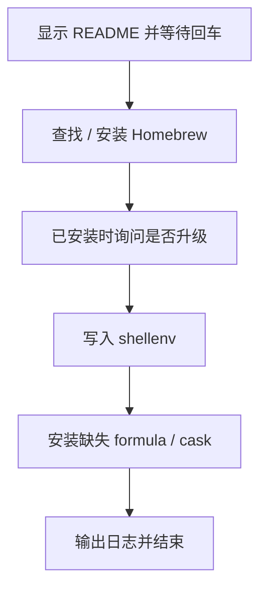

# `【MacOS】⚙️双击安装（升级）Homebrew.command` <a href="#前言" style="font-size:17px; color:green;"><b>🔼</b></a> <a href="#🔚" style="font-size:17px; color:green;"><b>🔽</b></a>


<!-- jobs-toc:start -->
<!-- jobs-toc:source {"v":2,"token":"[toc]"} -->
<details>
<summary>📚 目录（点击展开 / 收起）</summary>

- [🔥 前言](#jobs-toc-heading-1)
- [一、🎯 脚本定位](#jobs-toc-heading-2)
- [二、🧩 适用场景](#jobs-toc-heading-3)
- [三、🚀 快速开始](#jobs-toc-heading-4)
- [四、🧭 工作流程](#jobs-toc-heading-5)
- [五、⚠️ 注意事项](#jobs-toc-heading-6)
- [六、📁 文件结构](#jobs-toc-heading-7)
- [七、🪵 日志位置](#jobs-toc-heading-8)
- [八、🍺 Homebrew 自检标准](#jobs-toc-heading-9)

</details>
<!-- jobs-toc:end -->

## <span id="jobs-toc-heading-1" data-jobs-toc="v2">🔥 <font id=前言>前言</font></span><!-- jobs-toc:heading-end -->

- 采用 Shell 脚本的原因：Shell 来自 [**macOS**](https://www.apple.com/macos/) 原生系统底层，虽然写法相对繁琐冗杂，但执行效率高，并且不需要额外介入 [**Ruby**](https://www.ruby-lang.org)、[**Python**](https://www.python.org) 等第三方运行环境，因此具备更好的移植性。

> 当前总行数：

- 🔧**工欲善其事必先利其器**

- 🌋 **站在巨人的肩膀上，才能看得更远**

- ✝️ **面向信仰编程**

- 🔔 **温馨提示**：这个自述文件和同目录脚本是一一对应关系。双击脚本后，会先打印本文件内容并阻塞等待回车，避免误操作。

- 脚本日志默认写入：

  ```shell
  $TMPDIR/【MacOS】⚙️双击安装（升级）Homebrew.log
  ```

## <span id="jobs-toc-heading-2" data-jobs-toc="v2">一、🎯 脚本定位 <a href="#前言" style="font-size:17px; color:green;"><b>🔼</b></a> <a href="#🔚" style="font-size:17px; color:green;"><b>🔽</b></a></span><!-- jobs-toc:heading-end -->

**Homebrew 与常用开发工具安装脚本**

用于在 MacOS 上安装或接入 Homebrew，并补齐常用开发工具。已安装 Homebrew 时不会默认升级，必须输入任意字符才进入升级流程。

## <span id="jobs-toc-heading-3" data-jobs-toc="v2">二、🧩 适用场景 <a href="#前言" style="font-size:17px; color:green;"><b>🔼</b></a> <a href="#🔚" style="font-size:17px; color:green;"><b>🔽</b></a></span><!-- jobs-toc:heading-end -->

- 新 Mac 初始化开发环境。
- 已有 Homebrew，需要补装常用命令行工具。
- 希望把 brew shellenv 写入当前 shell 配置文件。

## <span id="jobs-toc-heading-4" data-jobs-toc="v2">三、🚀 快速开始 <a href="#前言" style="font-size:17px; color:green;"><b>🔼</b></a> <a href="#🔚" style="font-size:17px; color:green;"><b>🔽</b></a></span><!-- jobs-toc:heading-end -->

双击当前 `.command` 文件即可运行；也可以在终端中执行：

```shell
chmod +x './【MacOS】⚙️双击安装（升级）Homebrew.command'
./【MacOS】⚙️双击安装（升级）Homebrew.command
```

> 运行后先阅读终端打印的 README，确认无误后按回车继续。

## <span id="jobs-toc-heading-5" data-jobs-toc="v2">四、🧭 工作流程 <a href="#前言" style="font-size:17px; color:green;"><b>🔼</b></a> <a href="#🔚" style="font-size:17px; color:green;"><b>🔽</b></a></span><!-- jobs-toc:heading-end -->



## <span id="jobs-toc-heading-6" data-jobs-toc="v2">五、⚠️ 注意事项 <a href="#前言" style="font-size:17px; color:green;"><b>🔼</b></a> <a href="#🔚" style="font-size:17px; color:green;"><b>🔽</b></a></span><!-- jobs-toc:heading-end -->

- 会联网访问 Homebrew 官方安装脚本。
- 会安装多个开发工具，耗时取决于网络。
- 部分历史包可能已不可用，脚本会警告并继续。

## <span id="jobs-toc-heading-7" data-jobs-toc="v2">六、📁 文件结构 <a href="#前言" style="font-size:17px; color:green;"><b>🔼</b></a> <a href="#🔚" style="font-size:17px; color:green;"><b>🔽</b></a></span><!-- jobs-toc:heading-end -->

```text
【MacOS】⚙️双击安装（升级）Homebrew.command/
├── 【MacOS】⚙️双击安装（升级）Homebrew.command
└── README.md
```

## <span id="jobs-toc-heading-8" data-jobs-toc="v2">七、🪵 日志位置 <a href="#前言" style="font-size:17px; color:green;"><b>🔼</b></a> <a href="#🔚" style="font-size:17px; color:green;"><b>🔽</b></a></span><!-- jobs-toc:heading-end -->

```shell
$TMPDIR/【MacOS】⚙️双击安装（升级）Homebrew.log
```

## <span id="jobs-toc-heading-9" data-jobs-toc="v2">八、🍺 Homebrew 自检标准 <a href="#前言" style="font-size:17px; color:green;"><b>🔼</b></a> <a href="#🔚" style="font-size:17px; color:green;"><b>🔽</b></a></span><!-- jobs-toc:heading-end -->

- 已有 Homebrew 时保留原有维护交互，不因目录只读而自动另装。
- [**Homebrew**](https://brew.sh/) 安装路径由用户选择：已有可运行安装时复用；确实需要安装时先强提示，只有精确输入大写 `YES` 才选择系统标准目录，其它输入或直接回车选择当前用户的 `.local/homebrew`。`YES` 只表示选择路径，权限与密码由官方安装器实际处理；有管理员权限也可以选用户目录。选定路径失败立即停止，不自动切换；`Ctrl+C` / 输入结束取消整个任务。
- 用户目录安装需要可用 Git 与 curl；后续系统级软件仍可能要求管理员权限。

<a id="🔚" href="#前言" style="font-size:17px; color:green; font-weight:bold;">我是有底线的➤点我回到首页</a>
