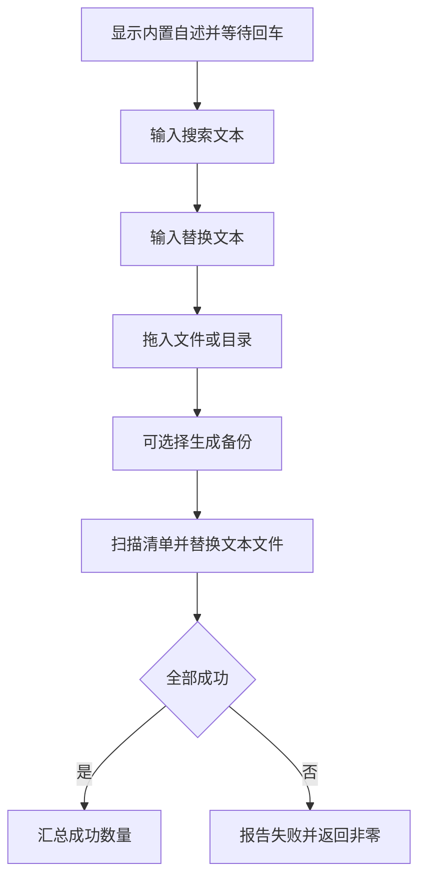

# `【MacOS】全文件搜索文字替换.command` <a href="#前言" style="font-size:17px; color:green;"><b>🔼</b></a> <a href="#🔚" style="font-size:17px; color:green;"><b>🔽</b></a>


<!-- jobs-toc:start -->
<!-- jobs-toc:source {"v":2,"token":"[toc]"} -->
<details>
<summary>📚 目录（点击展开 / 收起）</summary>

- [🔥 前言](#jobs-toc-heading-1)
- [一、🎯 脚本定位](#jobs-toc-heading-2)
- [二、🧩 适用场景](#jobs-toc-heading-3)
- [三、🚀 快速开始](#jobs-toc-heading-4)
- [四、🧭 工作流程](#jobs-toc-heading-5)
- [五、⚠️ 注意事项](#jobs-toc-heading-6)
- [六、📁 文件结构](#jobs-toc-heading-7)
- [七、🪵 日志位置](#jobs-toc-heading-8)

</details>
<!-- jobs-toc:end -->

## <span id="jobs-toc-heading-1" data-jobs-toc="v2">🔥 <font id=前言>前言</font></span><!-- jobs-toc:heading-end -->

- 采用 Shell 脚本的原因：Shell 来自 [**macOS**](https://www.apple.com/macos/) 原生系统底层，虽然写法相对繁琐冗杂，但执行效率高，并且不需要额外介入 [**Ruby**](https://www.ruby-lang.org)、[**Python**](https://www.python.org) 等第三方运行环境，因此具备更好的移植性。

> 当前总行数：

- 🔧**工欲善其事必先利其器**

- 🌋 **站在巨人的肩膀上，才能看得更远**

- ✝️ **面向信仰编程**

- 🔔 **温馨提示**：双击脚本后先打印内置用途说明并等待回车；输入结束或没有交互终端时取消，不执行替换。

- 脚本日志默认写入：

  ```shell
  系统临时目录 / 【MacOS】全文件搜索文字替换.log.随机编号
  ```

## <span id="jobs-toc-heading-2" data-jobs-toc="v2">一、🎯 脚本定位 <a href="#前言" style="font-size:17px; color:green;"><b>🔼</b></a> <a href="#🔚" style="font-size:17px; color:green;"><b>🔽</b></a></span><!-- jobs-toc:heading-end -->

**文件 / 目录文本搜索替换脚本**

用于对单个文件或目录下的文本文件进行字面量搜索替换。搜索文本不能为空，替换文本可以为空；正则符号和 `$` 等字符按原文处理。

目录模式跳过 `.git`、`node_modules`、`Pods`、`.dart_tool`、`build`、`DerivedData`、`dist`、`.build`、`PodsManual`、`ManualBy*Pods@Pods`、虚拟环境、缓存和供应商目录，不处理二进制文件、符号链接或已有的 `.bak` 文件。直接指定符号链接目标会报错退出。

| 操作 | 输入与结果 |
| --- | --- |
| 单文件替换 | 拖入普通文本文件，仅在包含搜索文本时修改 |
| 目录替换 | 先生成文件清单；扫描失败立即停止，不执行部分清单 |
| 备份 | 默认回车跳过；输入任意字符启用，写入前生成同名 `.bak`；已有备份或备份失败时保留该文件并报告失败 |
| 执行结果 | 显示成功替换文件数和失败数；先在同目录临时副本写入，成功后替换原文件；备份、读取、写入或改名失败返回非零，不显示整体处理完成；已成功的其它文件不自动回滚 |

## <span id="jobs-toc-heading-3" data-jobs-toc="v2">二、🧩 适用场景 <a href="#前言" style="font-size:17px; color:green;"><b>🔼</b></a> <a href="#🔚" style="font-size:17px; color:green;"><b>🔽</b></a></span><!-- jobs-toc:heading-end -->

- 批量替换项目中的旧字符串。
- 只想做字面量替换，不想写正则。
- 替换前可选择生成 `.bak` 备份。

## <span id="jobs-toc-heading-4" data-jobs-toc="v2">三、🚀 快速开始 <a href="#前言" style="font-size:17px; color:green;"><b>🔼</b></a> <a href="#🔚" style="font-size:17px; color:green;"><b>🔽</b></a></span><!-- jobs-toc:heading-end -->

双击当前 `.command` 文件即可运行；也可以在终端中执行：

```shell
chmod +x './【MacOS】全文件搜索文字替换.command'
./【MacOS】全文件搜索文字替换.command
```

> 运行后先阅读终端打印的内置自述，确认无误后按回车继续；脚本不会在运行时读取本 README。输入结束会取消。

## <span id="jobs-toc-heading-5" data-jobs-toc="v2">四、🧭 工作流程 <a href="#前言" style="font-size:17px; color:green;"><b>🔼</b></a> <a href="#🔚" style="font-size:17px; color:green;"><b>🔽</b></a></span><!-- jobs-toc:heading-end -->



## <span id="jobs-toc-heading-6" data-jobs-toc="v2">五、⚠️ 注意事项 <a href="#前言" style="font-size:17px; color:green;"><b>🔼</b></a> <a href="#🔚" style="font-size:17px; color:green;"><b>🔽</b></a></span><!-- jobs-toc:heading-end -->

- 会直接修改命中文件。
- 建议先用 Git 管理或选择生成 `.bak`。
- 不处理二进制文件、符号链接和目录扫描中的 `.bak` 备份。
- 已有 `.bak` 不覆盖；请先核对、保存或移走旧备份，再重新执行。

## <span id="jobs-toc-heading-7" data-jobs-toc="v2">六、📁 文件结构 <a href="#前言" style="font-size:17px; color:green;"><b>🔼</b></a> <a href="#🔚" style="font-size:17px; color:green;"><b>🔽</b></a></span><!-- jobs-toc:heading-end -->

```text
【MacOS】全文件搜索文字替换.command/
├── 【MacOS】全文件搜索文字替换.command
└── README.md
```

## <span id="jobs-toc-heading-8" data-jobs-toc="v2">七、🪵 日志位置 <a href="#前言" style="font-size:17px; color:green;"><b>🔼</b></a> <a href="#🔚" style="font-size:17px; color:green;"><b>🔽</b></a></span><!-- jobs-toc:heading-end -->

```shell
系统临时目录 / 【MacOS】全文件搜索文字替换.log.随机编号
```

确认运行后才创建私有日志，终端会打印本次的具体路径，重复运行使用不同文件。隔离回归位于上级工作区的 `Tests/test_text_replacement.py`，只使用临时文件和替身命令；不以真实项目批量替换作为测试。

<a id="🔚" href="#前言" style="font-size:17px; color:green; font-weight:bold;">我是有底线的➤点我回到首页</a>
