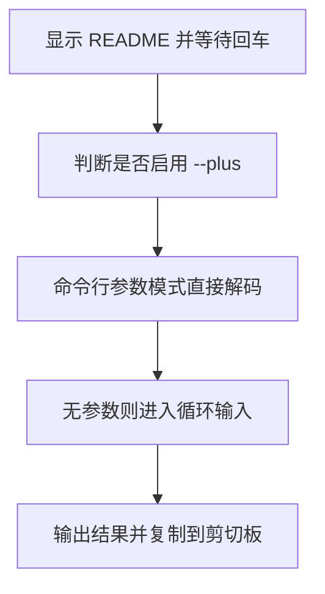

# `【MacOS】去乱码.command` <a href="#前言" style="font-size:17px; color:green;"><b>🔼</b></a> <a href="#🔚" style="font-size:17px; color:green;"><b>🔽</b></a>


<!-- jobs-toc:start -->
<!-- jobs-toc:source {"v":2,"token":"[toc]"} -->
<details>
<summary>📚 目录（点击展开 / 收起）</summary>

- [🔥 前言](#jobs-toc-heading-1)
- [一、🎯 脚本定位](#jobs-toc-heading-2)
- [二、🧩 适用场景](#jobs-toc-heading-3)
- [三、🚀 快速开始](#jobs-toc-heading-4)
- [四、🧭 工作流程](#jobs-toc-heading-5)
- [五、⚠️ 注意事项](#jobs-toc-heading-6)
- [六、📁 文件结构](#jobs-toc-heading-7)
- [七、🪵 日志位置](#jobs-toc-heading-8)

</details>
<!-- jobs-toc:end -->

> **Python 环境预检**：实际调用 [**Python**](https://www.python.org/) 前使用本文件内嵌的环境预检函数，通过 [**Homebrew**](https://brew.sh/) 管理运行时；脚本可单文件复制运行，不需要旁边的支持目录。终端自述确认后执行 `brew update` 更新本体及公式索引；只在指定公式 `python@3.13` 缺失、损坏或版本不满足 `3.11+` 时安装或修复，健康运行时直接复用。缺失 Homebrew 时强提示选安装路径：精确大写 `YES` 选系统标准目录，其它输入或回车选用户目录；失败停止，不自动换路。必需安装或修复直接回车执行，任意非空输入（含空格）取消。预检不执行全局 `brew upgrade`。

## <span id="jobs-toc-heading-1" data-jobs-toc="v2">🔥 <font id=前言>前言</font></span><!-- jobs-toc:heading-end -->

- 脚本入口使用 macOS 原生 Shell；其中的解析、转换或服务功能需要下述已验证的 Python 运行时。

> 当前总行数：

- 🔧**工欲善其事必先利其器**

- 🌋 **站在巨人的肩膀上，才能看得更远**

- ✝️ **面向信仰编程**

- 🔔 **温馨提示**：这个自述文件和同目录脚本是一一对应关系。双击脚本后，会先打印本文件内容并阻塞等待回车，避免误操作。

- 脚本日志默认写入：

  ```shell
  $TMPDIR/【MacOS】去乱码.log
  ```

## <span id="jobs-toc-heading-2" data-jobs-toc="v2">一、🎯 脚本定位 <a href="#前言" style="font-size:17px; color:green;"><b>🔼</b></a> <a href="#🔚" style="font-size:17px; color:green;"><b>🔽</b></a></span><!-- jobs-toc:heading-end -->

**URL 编码解码脚本**

用于把 `%E7%...` 这类 URL 编码字符串解码为中文或可读文本，并复制到剪切板。

## <span id="jobs-toc-heading-3" data-jobs-toc="v2">二、🧩 适用场景 <a href="#前言" style="font-size:17px; color:green;"><b>🔼</b></a> <a href="#🔚" style="font-size:17px; color:green;"><b>🔽</b></a></span><!-- jobs-toc:heading-end -->

- 从浏览器、日志、接口参数中拿到 URL 编码文本。
- 需要快速解码中文路径或 query 参数。
- 需要把 + 当空格解析时可传入 --plus。

## <span id="jobs-toc-heading-4" data-jobs-toc="v2">三、🚀 快速开始 <a href="#前言" style="font-size:17px; color:green;"><b>🔼</b></a> <a href="#🔚" style="font-size:17px; color:green;"><b>🔽</b></a></span><!-- jobs-toc:heading-end -->

双击当前 `.command` 文件即可运行；也可以在终端中执行：

```shell
chmod +x './【MacOS】去乱码.command'
./【MacOS】去乱码.command --plus "%E4%BD%A0%E5%A5%BD+Jobs"
```

> 运行后先阅读终端打印的 README，确认无误后按回车继续。

## <span id="jobs-toc-heading-5" data-jobs-toc="v2">四、🧭 工作流程 <a href="#前言" style="font-size:17px; color:green;"><b>🔼</b></a> <a href="#🔚" style="font-size:17px; color:green;"><b>🔽</b></a></span><!-- jobs-toc:heading-end -->



## <span id="jobs-toc-heading-6" data-jobs-toc="v2">五、⚠️ 注意事项 <a href="#前言" style="font-size:17px; color:green;"><b>🔼</b></a> <a href="#🔚" style="font-size:17px; color:green;"><b>🔽</b></a></span><!-- jobs-toc:heading-end -->

- 依赖内嵌预检选定的 Homebrew Python；Ruby 仅保留为原有解码回退。
- 只做解码，不会修改文件。

## <span id="jobs-toc-heading-7" data-jobs-toc="v2">六、📁 文件结构 <a href="#前言" style="font-size:17px; color:green;"><b>🔼</b></a> <a href="#🔚" style="font-size:17px; color:green;"><b>🔽</b></a></span><!-- jobs-toc:heading-end -->

```text
【MacOS】去乱码.command/
├── 【MacOS】去乱码.command
└── README.md
```

## <span id="jobs-toc-heading-8" data-jobs-toc="v2">七、🪵 日志位置 <a href="#前言" style="font-size:17px; color:green;"><b>🔼</b></a> <a href="#🔚" style="font-size:17px; color:green;"><b>🔽</b></a></span><!-- jobs-toc:heading-end -->

```shell
$TMPDIR/【MacOS】去乱码.log
```

<a id="🔚" href="#前言" style="font-size:17px; color:green; font-weight:bold;">我是有底线的➤点我回到首页</a>
