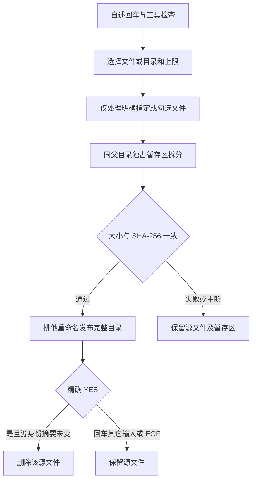
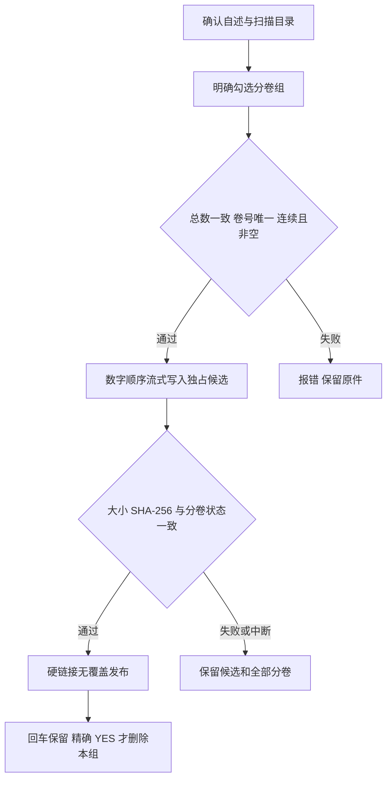
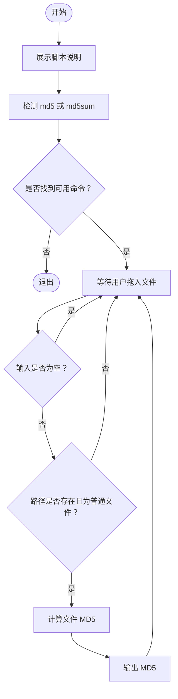

# <span id="file-volume-tools">**MacOS 文件子卷工具脚本说明**</span>


<!-- jobs-toc:start -->
<!-- jobs-toc:source {"v":2,"token":"[toc]"} -->
<details>
<summary>📚 目录（点击展开 / 收起）</summary>

- [一、前言](#%E5%89%8D%E8%A8%80)
- [二、脚本总览](#jobs-toc-heading-2)
- [三、工作流程](#jobs-toc-heading-3)
  - [3.1、赋予执行权限](#jobs-toc-heading-4)
  - [3.2、拆分大文件](#jobs-toc-heading-5)
  - [3.3、合并子卷文件](#jobs-toc-heading-6)
  - [3.4、计算文件 MD5](#jobs-toc-heading-7)
- [四、【MacOS】✂️源文件压缩拆分➤子卷.command 详细说明](#jobs-toc-heading-8)
  - [4.1、输入、选择与输出](#jobs-toc-heading-9)
  - [4.2、命名与分卷大小](#jobs-toc-heading-10)
  - [4.3、校验、发布与取消](#jobs-toc-heading-11)
- [五、【MacOS】🧩子卷➤合而为一源文件.command 详细说明](#jobs-toc-heading-12)
  - [5.1、扫描与输出位置](#jobs-toc-heading-13)
  - [5.2、完整性与无覆盖发布](#jobs-toc-heading-14)
  - [5.3、精确删除边界](#jobs-toc-heading-15)
- [六、【MacOS】🧬MD5.command 详细说明](#jobs-toc-heading-16)
  - [6.1、流程简述](#jobs-toc-heading-17)
  - [6.2、脚本定位](#jobs-toc-heading-18)
  - [6.3、MD5 工具检测](#jobs-toc-heading-19)
  - [6.4、输入规则](#jobs-toc-heading-20)
  - [6.5、空输入行为](#jobs-toc-heading-21)
  - [6.6、推荐校验方式](#jobs-toc-heading-22)
- [七、文件命名与目录结构建议](#jobs-toc-heading-23)
  - [7.1、推荐目录结构](#jobs-toc-heading-24)
  - [7.2、文件名与卷号后缀](#jobs-toc-heading-25)
  - [7.3、不推荐的目录结构](#jobs-toc-heading-26)
- [八、日志文件](#jobs-toc-heading-27)
- [九、常见使用场景](#jobs-toc-heading-28)
  - [场景 1：大文件准备放进 GitHub 普通仓库](#jobs-toc-heading-29)
  - [场景 2：大文件准备走 GitHub Releases](#jobs-toc-heading-30)
  - [场景 3：没有安装 fzf](#jobs-toc-heading-31)
  - [场景 4：只想计算 MD5](#jobs-toc-heading-32)
- [十、失败排查顺序](#jobs-toc-heading-33)
  - [10.1、拆分脚本失败](#jobs-toc-heading-34)
  - [10.2、合并脚本失败](#jobs-toc-heading-35)
  - [10.3、MD5 脚本失败](#jobs-toc-heading-36)
- [十一、FAQ](#jobs-toc-heading-37)
  - [11.1、这个拆分脚本真的会压缩文件吗？](#jobs-toc-heading-38)
  - [11.2、为什么默认是 50 MiB？](#jobs-toc-heading-39)
  - [11.3、为什么大分卷标准使用 1900 MiB？](#jobs-toc-heading-40)
  - [11.4、为什么拆分后的子卷不是每个都刚好等于我选择的大小？](#jobs-toc-heading-41)
  - [11.5、为什么合并脚本要求文件名里有 @？](#jobs-toc-heading-42)
  - [11.6、源文件名能不能包含 @？](#jobs-toc-heading-43)
  - [11.7、自动校验与 MD5 工具各负责什么？](#jobs-toc-heading-44)
  - [11.8、为什么 MD5 脚本直接按 Enter 不退出？](#jobs-toc-heading-45)
  - [11.9、为什么合并时提示目标文件已存在？](#jobs-toc-heading-46)
  - [11.10、为什么拆分成功后不建议立刻删除源文件？](#jobs-toc-heading-47)
- [十二、设计原则](#jobs-toc-heading-48)
- [十三、外部链接](#jobs-toc-heading-49)

</details>
<!-- jobs-toc:end -->

## <span id="前言">一、前言</span>

- 这个自述文件说明三个 MacOS `.command` 脚本：拆分、合并工具包位于本目录，MD5 工具包与分卷测试样本集中在仓库根目录的 [Release](../../Release/README.md)。下文命令均以本 `README.md` 所在目录为基准。

  ```text
  【MacOS】✂️源文件压缩拆分➤子卷.command
  【MacOS】🧩子卷➤合而为一源文件.command
  【MacOS】🧬MD5.command
  ```

- 共享资源位置：

  | 资源 | 当前路径与用途 |
  |---|---|
  | [MD5 工具包](<../../Release/【MacOS】🧬MD5.command/README.md>) | `../../Release/【MacOS】🧬MD5.command/`，包含主脚本与配套说明。 |
  | [libiPhone-lib 分卷样本](../../Release/libiPhone-lib/) | `../../Release/libiPhone-lib/`，包含 `libiPhone-lib.a@001of004` 至 `libiPhone-lib.a@004of004` 四个二进制分卷。 |

- 合并该样本时，目标目录选择 `../../Release/`，脚本扫描其一级子目录 `libiPhone-lib/`，输出为 `../../Release/libiPhone-lib.a`；合并后在删除提示处直接回车，保留测试分卷。样本不含 Windows `JobsSplit-1` 的 `manifest.json`，应交给 Windows 子卷合并入口的默认原始卷模式，不使用 `-LegacyManifest`。

- 这三个脚本是一组本地文件处理工具，主要用于：

  * 把大文件按指定体积拆成多个子卷文件。
  * 把拆出来的子卷文件重新合并成源文件。
  * 计算文件的 MD5，方便人工核对文件一致性。

- 其中 `【MacOS】✂️源文件压缩拆分➤子卷.command` 名字里带有“压缩”，但按当前脚本实现来看，它实际执行的是 **二进制拆分**，不是 ZIP / tar / 7z 这种压缩归档。也就是说，文件内容不会被压缩，只会被按体积切分。

- 如果你确实想“先压缩、再拆分”，建议先手动生成 `.zip`、`.tar.gz` 或其他压缩包，再把压缩包交给拆分脚本处理。

- 拆分脚本默认使用 `50 MiB` 作为保守拆分标准，也可以选择 `100 MiB`、GitHub Releases 安全标准或自定义 MiB 数值。

- 合并脚本依赖拆分脚本生成的命名规则。不要手动改动子卷文件名，否则合并脚本可能无法正确识别顺序和源文件名。

- 拆分、合并使用 [**fzf**](https://github.com/junegunn/fzf) 与 macOS 系统命令；只检查工具，不安装、升级或修改 Shell 配置。拆分目录以系统 JXA 调用排他重命名发布，不需要 Python、Node.js 或编译器。

- 两套命名入口与 `WindowsOS_11/split.command`、`merge.command` 分别保持相同源码，均可单文件独立运行；标题和日志按自身文件名生成。

- 流程图可以复制到 [**ProcessOn**](https://www.processon.com/) 或支持 Mermaid 的 Markdown 工具中查看。

---

## <span id="jobs-toc-heading-2" data-jobs-toc="v2">二、脚本总览 <a href="#前言" style="font-size:17px; color:green;"><b>🔼</b></a> <a href="#🔚" style="font-size:17px; color:green;"><b>🔽</b></a></span><!-- jobs-toc:heading-end -->

| 脚本 | 作用 | 是否需要 Homebrew | 是否需要 fzf | 主要输出 |
|---|---|---|---|---|
| `【MacOS】✂️源文件压缩拆分➤子卷.command` | 单文件或目录勾选拆分 | 不需要 | 必需，用于上限及目录多选 | 经 SHA-256 验证的新子卷目录 |
| `【MacOS】🧩子卷➤合而为一源文件.command` | 平铺、分卷目录或父目录按组还原 | 不需要 | 必需，用于明确勾选分卷组 | 经流摘要验证的完整文件 |
| `【MacOS】🧬MD5.command` | 计算文件 MD5 | 不需要 | 不需要 | MD5 字符串 |

---

## <span id="jobs-toc-heading-3" data-jobs-toc="v2">三、工作流程 <a href="#前言" style="font-size:17px; color:green;"><b>🔼</b></a> <a href="#🔚" style="font-size:17px; color:green;"><b>🔽</b></a></span><!-- jobs-toc:heading-end -->

### <span id="jobs-toc-heading-4" data-jobs-toc="v2">3.1、赋予执行权限 <a href="#前言" style="font-size:17px; color:green;"><b>🔼</b></a> <a href="#🔚" style="font-size:17px; color:green;"><b>🔽</b></a></span><!-- jobs-toc:heading-end -->

三个脚本首次下载后，建议先赋予执行权限：

```shell
chmod +x './【MacOS】✂️源文件压缩拆分➤子卷.command/【MacOS】✂️源文件压缩拆分➤子卷.command'
chmod +x './【MacOS】🧩子卷➤合而为一源文件.command/【MacOS】🧩子卷➤合而为一源文件.command'
chmod +x '../../Release/【MacOS】🧬MD5.command/【MacOS】🧬MD5.command'
```

---

### <span id="jobs-toc-heading-5" data-jobs-toc="v2">3.2、拆分大文件 <a href="#前言" style="font-size:17px; color:green;"><b>🔼</b></a> <a href="#🔚" style="font-size:17px; color:green;"><b>🔽</b></a></span><!-- jobs-toc:heading-end -->

运行后先阅读内置自述并回车，拖入单个文件或目录；也可直接传入一个位置参数：

```shell
/bin/zsh './【MacOS】✂️源文件压缩拆分➤子卷.command/【MacOS】✂️源文件压缩拆分➤子卷.command' \
  '/待拆分/大文件.iso'
```

随后以 fzf 选择 50 MiB、100 MiB、1900 MiB 或自定义 MiB。单文件模式只处理指定文件；目录模式只扫描本层符合条件的文件，并明确勾选。大小及 SHA-256 验证通过后发布新目录；已有目标拒绝覆盖，回车保留源文件。

---

### <span id="jobs-toc-heading-6" data-jobs-toc="v2">3.3、合并子卷文件 <a href="#前言" style="font-size:17px; color:green;"><b>🔼</b></a> <a href="#🔚" style="font-size:17px; color:green;"><b>🔽</b></a></span><!-- jobs-toc:heading-end -->

拖入父目录扫描本层和一级子目录，也可直接拖入分卷目录：

```shell
/bin/zsh './【MacOS】🧩子卷➤合而为一源文件.command/【MacOS】🧩子卷➤合而为一源文件.command' \
  '/工作目录/大文件'
```

显式指定的目录本层有分卷时，本层组还原到其父目录；扫描父目录时，子目录组还原到所选父目录。直接回车默认扫描脚本目录，本层平铺分卷输出到该默认目录。fzf 始终要求明确勾选组；检查连续卷号后按数字排序合并，经大小、SHA-256 和输入状态校验再无覆盖发布。默认保留分卷，仅精确输入 `YES` 才删除本组清单，目录仍有其它内容时保留。

---

### <span id="jobs-toc-heading-7" data-jobs-toc="v2">3.4、计算文件 MD5 <a href="#前言" style="font-size:17px; color:green;"><b>🔼</b></a> <a href="#🔚" style="font-size:17px; color:green;"><b>🔽</b></a></span><!-- jobs-toc:heading-end -->

运行：

```shell
../../Release/'【MacOS】🧬MD5.command/【MacOS】🧬MD5.command'
```

正常流程：

- 展示脚本说明。
- 自动检测系统中可用的 `md5` 或 `md5sum`。
- 拖入文件路径。
- 输出 MD5。
- 继续等待下一个文件。

注意：当前脚本实际行为是 **空输入不会退出**，会继续等待输入；如果要退出，请按：

```text
Ctrl+C
```

---

## <span id="jobs-toc-heading-8" data-jobs-toc="v2">四、`【MacOS】✂️源文件压缩拆分➤子卷.command` 详细说明 <a href="#前言" style="font-size:17px; color:green;"><b>🔼</b></a> <a href="#🔚" style="font-size:17px; color:green;"><b>🔽</b></a></span><!-- jobs-toc:heading-end -->

### <span id="jobs-toc-heading-9" data-jobs-toc="v2">4.1、输入、选择与输出 <a href="#前言" style="font-size:17px; color:green;"><b>🔼</b></a> <a href="#🔚" style="font-size:17px; color:green;"><b>🔽</b></a></span><!-- jobs-toc:heading-end -->

- 支持拖入单个普通文件或目录，或通过一个位置参数传入；不接受多个路径。路径可包含空格、中文、引号、`@` 等字符；安全去引用，不执行输入中的命令。
- 空输入使用脚本目录。目录模式仅扫描当前层，排除隐藏项和已有分卷，且只处理大于所选上限的文件；单文件模式只处理明确指定的文件，符号链接拒绝处理。
- fzf 上限单选：回车确认、Esc 取消；自定义使用 MiB，允许小数，换算后至少一个字节。目录文件多选：回车勾选 / 取消、空格确认、Ctrl+A 全选、Ctrl+D 清空、`←` 返回上限、Esc 取消。空选不处理高亮项。
- 文件未超过上限时可返回调低上限；上层标准变更后重新计算待选文件。单文件无需再次勾选文件。

| 源文件 | 新分卷目录 |
| --- | --- |
| `image.iso` | `image/` |
| `archive.tar.gz` | `archive.tar/` |
| `README` | `README.parts/` |

### <span id="jobs-toc-heading-10" data-jobs-toc="v2">4.2、命名与分卷大小 <a href="#前言" style="font-size:17px; color:green;"><b>🔼</b></a> <a href="#🔚" style="font-size:17px; color:green;"><b>🔽</b></a></span><!-- jobs-toc:heading-end -->

完整原文件名保留，卷名为 `文件名@序号of总数`。新生成的序号和总数按实际总卷数位宽补零；已有 `001of004` 等更宽编号同样可合并。不是压缩归档，不改变文件内容。

设文件大小为 `S`、上限为 `L`，计划卷数为 `ceil(S/L)`，实际主卷大小为 `ceil(S/计划卷数)`；每卷大于零且不超过上限，尾卷不刻意补齐。50 MiB 是 `50 × 1024 × 1024` 字节。

### <span id="jobs-toc-heading-11" data-jobs-toc="v2">4.3、校验、发布与取消 <a href="#前言" style="font-size:17px; color:green;"><b>🔼</b></a> <a href="#🔚" style="font-size:17px; color:green;"><b>🔽</b></a></span><!-- jobs-toc:heading-end -->



拆分前源摘要、分卷流摘要及拆分后源摘要必须一致，发布后再次校验完整分卷清单。目标已存在（包括目录或符号链接）直接报错；系统或文件系统不支持排他发布时安全停止，不回退为覆盖或嵌套移动。失败、中断保留候选并显示路径，源文件不因失败而删除。

---

## <span id="jobs-toc-heading-12" data-jobs-toc="v2">五、`【MacOS】🧩子卷➤合而为一源文件.command` 详细说明 <a href="#前言" style="font-size:17px; color:green;"><b>🔼</b></a> <a href="#🔚" style="font-size:17px; color:green;"><b>🔽</b></a></span><!-- jobs-toc:heading-end -->

### <span id="jobs-toc-heading-13" data-jobs-toc="v2">5.1、扫描与输出位置 <a href="#前言" style="font-size:17px; color:green;"><b>🔼</b></a> <a href="#🔚" style="font-size:17px; color:green;"><b>🔽</b></a></span><!-- jobs-toc:heading-end -->

| 输入方式 | 扫描范围 | 输出位置 |
| --- | --- | --- |
| 回车使用脚本目录 | 本层及一级子目录 | 脚本目录 |
| 显式父目录，本层没有分卷 | 一级子目录 | 所选父目录 |
| 显式分卷目录，本层含合法格式分卷 | 本层及一级子目录 | 本层组到父目录，子目录组到所选目录 |

同目录按完整原文件名分别分组，支持同层多组，不把它们互相拼接。`.partial` 不参与合并；扫描跳过缓存、第三方和隐藏子目录。fzf 使用回车勾选 / 取消、空格确认、Ctrl+A 全选、Ctrl+D 清空、Esc 取消，空选或取消不会默认全选。

### <span id="jobs-toc-heading-14" data-jobs-toc="v2">5.2、完整性与无覆盖发布 <a href="#前言" style="font-size:17px; color:green;"><b>🔼</b></a> <a href="#🔚" style="font-size:17px; color:green;"><b>🔽</b></a></span><!-- jobs-toc:heading-end -->



- 使用末尾合法 `@数字of数字` 后缀解析，保留原文件名内已有的 `@`。
- 卷号按十进制数值排序，兼容 `1` / `01` 等补零；同组同时出现 `1` 与 `01` 视为重复。缺号、总数冲突、零号、越界号和空卷都拒绝合并。
- 流式读取不把大文件整体放入内存；候选大小、复制流摘要和落盘摘要一致，且输入身份 / 大小 / 修改状态未变，才发布目标。
- 已有目标一律保留，不提供覆盖确认；并发出现文件、目录或符号链接时发布失败并保留候选。
- 此 SHA-256 验证复制一致性；没有可信原始摘要时不能验证下载来源。MD5 工具继续独立提供人工比对。

### <span id="jobs-toc-heading-15" data-jobs-toc="v2">5.3、精确删除边界 <a href="#前言" style="font-size:17px; color:green;"><b>🔼</b></a> <a href="#🔚" style="font-size:17px; color:green;"><b>🔽</b></a></span><!-- jobs-toc:heading-end -->

回车、其它输入或 EOF 保留全部分卷。只有精确输入 `YES`，并再次复核输入状态，才删除已经合并的本组清单；不递归删除目录，也不删除无关文件。空分卷子目录可以移除，仍有其它内容则保留。某组失败继续汇总其它所选组，并返回真实失败状态。

---

## <span id="jobs-toc-heading-16" data-jobs-toc="v2">六、`【MacOS】🧬MD5.command` 详细说明 <a href="#前言" style="font-size:17px; color:green;"><b>🔼</b></a> <a href="#🔚" style="font-size:17px; color:green;"><b>🔽</b></a></span><!-- jobs-toc:heading-end -->

### <span id="jobs-toc-heading-17" data-jobs-toc="v2">6.1、流程简述 <a href="#前言" style="font-size:17px; color:green;"><b>🔼</b></a> <a href="#🔚" style="font-size:17px; color:green;"><b>🔽</b></a></span><!-- jobs-toc:heading-end -->



---

### <span id="jobs-toc-heading-18" data-jobs-toc="v2">6.2、脚本定位 <a href="#前言" style="font-size:17px; color:green;"><b>🔼</b></a> <a href="#🔚" style="font-size:17px; color:green;"><b>🔽</b></a></span><!-- jobs-toc:heading-end -->

`【MacOS】🧬MD5.command` 用于计算文件 MD5。

它适合这些场景：

- 拆分前计算源文件 MD5。
- 合并后计算输出文件 MD5。
- 对比两个文件是否字节一致。
- 记录文件校验值，方便跨机器核对。

---

### <span id="jobs-toc-heading-19" data-jobs-toc="v2">6.3、MD5 工具检测 <a href="#前言" style="font-size:17px; color:green;"><b>🔼</b></a> <a href="#🔚" style="font-size:17px; color:green;"><b>🔽</b></a></span><!-- jobs-toc:heading-end -->

脚本会优先检测 macOS 自带的：

```shell
md5
```

如果没有，再检测 Linux 常见的：

```shell
md5sum
```

优先级如下：

| 优先级 | 命令 | 说明 |
|---:|---|---|
| 1 | `md5` | macOS 自带 |
| 2 | `md5sum` | Linux / GNU coreutils 常见 |
| - | 都不存在 | 报错退出 |

---

### <span id="jobs-toc-heading-20" data-jobs-toc="v2">6.4、输入规则 <a href="#前言" style="font-size:17px; color:green;"><b>🔼</b></a> <a href="#🔚" style="font-size:17px; color:green;"><b>🔽</b></a></span><!-- jobs-toc:heading-end -->

脚本会反复提示：

```text
请拖入要计算 MD5 的文件，然后回车：
```

支持：

- Finder 拖入文件。
- 手动输入文件路径。
- 带引号的路径。
- 路径前后带空格。

脚本会自动处理：

- 去掉末尾 `\r`。
- 去掉首尾空白字符。
- 去掉首尾成对引号。
- 检查路径是否存在。
- 检查目标是否为普通文件。

---

### <span id="jobs-toc-heading-21" data-jobs-toc="v2">6.5、空输入行为 <a href="#前言" style="font-size:17px; color:green;"><b>🔼</b></a> <a href="#🔚" style="font-size:17px; color:green;"><b>🔽</b></a></span><!-- jobs-toc:heading-end -->

当前脚本开头说明写的是：

```text
如果不想继续算了，直接按 [Enter]（空输入）即可退出。
```

但脚本实际逻辑不是这样。

当前实际行为是：

| 输入 | 实际行为 |
|---|---|
| 直接按 `[Enter]` | 不退出，继续等待 |
| 只输入空格 | 不退出，继续等待 |
| `Ctrl+C` | 退出脚本 |

所以 README 按真实行为写：退出脚本请按 `Ctrl+C`。

---

### <span id="jobs-toc-heading-22" data-jobs-toc="v2">6.6、推荐校验方式 <a href="#前言" style="font-size:17px; color:green;"><b>🔼</b></a> <a href="#🔚" style="font-size:17px; color:green;"><b>🔽</b></a></span><!-- jobs-toc:heading-end -->

拆分前，先计算源文件 MD5：

```text
源文件 MD5：aaaaaaaaaaaaaaaaaaaaaaaaaaaaaaaa
```

合并后，再计算合并文件 MD5：

```text
合并文件 MD5：aaaaaaaaaaaaaaaaaaaaaaaaaaaaaaaa
```

如果两个 MD5 完全一致，说明文件字节内容一致。

如果不一致，优先检查：

- 是否缺少某个子卷。
- 子卷文件名是否被改过。
- 是否合并到了旧文件上。
- 是否覆盖了错误文件。
- 是否混入了其他 `@` 文件。
- 原始文件名是否包含 `@`。

---

## <span id="jobs-toc-heading-23" data-jobs-toc="v2">七、文件命名与目录结构建议 <a href="#前言" style="font-size:17px; color:green;"><b>🔼</b></a> <a href="#🔚" style="font-size:17px; color:green;"><b>🔽</b></a></span><!-- jobs-toc:heading-end -->

### <span id="jobs-toc-heading-24" data-jobs-toc="v2">7.1、推荐目录结构 <a href="#前言" style="font-size:17px; color:green;"><b>🔼</b></a> <a href="#🔚" style="font-size:17px; color:green;"><b>🔽</b></a></span><!-- jobs-toc:heading-end -->

仓库中的工具包与测试样本按以下结构存放；MD5 工具包内的脚本与 `README.md` 保持同层：

```text
JobsCommand@Others/
├── Release/
│   ├── README.md
│   ├── 【MacOS】🧬MD5.command/
│   │   ├── 【MacOS】🧬MD5.command
│   │   └── README.md
│   └── libiPhone-lib/
│       ├── libiPhone-lib.a@001of004
│       ├── libiPhone-lib.a@002of004
│       ├── libiPhone-lib.a@003of004
│       └── libiPhone-lib.a@004of004
└── MacOS/
    └── 【MacOS】文件分拆（合并）测试. command/
        ├── README.md
        ├── 【MacOS】✂️源文件压缩拆分➤子卷.command/
        │   ├── 【MacOS】✂️源文件压缩拆分➤子卷.command
        │   └── README.md
        └── 【MacOS】🧩子卷➤合而为一源文件.command/
            ├── 【MacOS】🧩子卷➤合而为一源文件.command
            └── README.md
```

实际处理文件时，建议单独准备工作目录：

```text
Work/
├── BigVideo.mp4
├── Data.zip
└── Backup.dmg
```

拆分后默认仍保留源文件；下图仅展开分卷目录（示例使用受支持的三位编号）：

```text
Work/
├── BigVideo/
│   ├── BigVideo.mp4@001of003
│   ├── BigVideo.mp4@002of003
│   └── BigVideo.mp4@003of003
├── Data/
│   ├── Data.zip@001of002
│   └── Data.zip@002of002
└── Backup/
    ├── Backup.dmg@001of004
    ├── Backup.dmg@002of004
    ├── Backup.dmg@003of004
    └── Backup.dmg@004of004
```

合并后：

```text
Work/
├── BigVideo.mp4
├── Data.zip
├── Backup.dmg
├── BigVideo/
├── Data/
└── Backup/
```

如果合并成功后选择删除子卷目录，则最终可能变成：

```text
Work/
├── BigVideo.mp4
├── Data.zip
└── Backup.dmg
```

---

### <span id="jobs-toc-heading-25" data-jobs-toc="v2">7.2、文件名与卷号后缀 <a href="#前言" style="font-size:17px; color:green;"><b>🔼</b></a> <a href="#🔚" style="font-size:17px; color:green;"><b>🔽</b></a></span><!-- jobs-toc:heading-end -->

源文件名允许包含 `@`，例如 `A@B.zip`。合并器从最后一个合法 `@序号of总数` 后缀解析，完整保留名称；不要修改卷号后缀、遗漏分卷或混入同名重复卷。

---

### <span id="jobs-toc-heading-26" data-jobs-toc="v2">7.3、不推荐的目录结构 <a href="#前言" style="font-size:17px; color:green;"><b>🔼</b></a> <a href="#🔚" style="font-size:17px; color:green;"><b>🔽</b></a></span><!-- jobs-toc:heading-end -->

同目录多组已按完整原文件名隔离处理；为便于人工检查，仍建议分别放目录。以下平铺形式也支持：

```text
Bad/
├── A.zip@001of002
├── A.zip@002of002
├── B.zip@001of002
└── B.zip@002of002
```

应该分开：

```text
Good/
├── A/
│   ├── A.zip@001of002
│   └── A.zip@002of002
└── B/
    ├── B.zip@001of002
    └── B.zip@002of002
```

---

## <span id="jobs-toc-heading-27" data-jobs-toc="v2">八、日志文件 <a href="#前言" style="font-size:17px; color:green;"><b>🔼</b></a> <a href="#🔚" style="font-size:17px; color:green;"><b>🔽</b></a></span><!-- jobs-toc:heading-end -->

三个脚本都会把运行日志写入 `$TMPDIR`。

日志文件名来自脚本文件名去掉 `.command` 后拼接 `.log`。

例如：

```text
$TMPDIR/【MacOS】✂️源文件压缩拆分➤子卷.log
$TMPDIR/【MacOS】🧩子卷➤合而为一源文件.log
$TMPDIR/【MacOS】🧬MD5.log
```

排查问题时，优先查看终端最后一个 `✖` 报错，再查看对应日志。

示例：

```shell
cat "${TMPDIR:-/tmp}/【MacOS】✂️源文件压缩拆分➤子卷.log"
cat "${TMPDIR:-/tmp}/【MacOS】🧩子卷➤合而为一源文件.log"
cat "${TMPDIR:-/tmp}/【MacOS】🧬MD5.log"
```

---

## <span id="jobs-toc-heading-28" data-jobs-toc="v2">九、常见使用场景 <a href="#前言" style="font-size:17px; color:green;"><b>🔼</b></a> <a href="#🔚" style="font-size:17px; color:green;"><b>🔽</b></a></span><!-- jobs-toc:heading-end -->

### <span id="jobs-toc-heading-29" data-jobs-toc="v2">场景 1：大文件准备放进 GitHub 普通仓库 <a href="#前言" style="font-size:17px; color:green;"><b>🔼</b></a> <a href="#🔚" style="font-size:17px; color:green;"><b>🔽</b></a></span><!-- jobs-toc:heading-end -->

GitHub 普通仓库对大文件有限制。脚本默认的 `50 MiB` 是比较保守的拆分标准。

推荐流程：

1. 运行 MD5 脚本，记录源文件 MD5。
2. 运行拆分脚本，选择 `50 MiB` 或 `100 MiB`。
3. 确认拆分结果。
4. 不建议立刻删除源文件。
5. 到另一台机器后运行合并脚本。
6. 合并后再次计算 MD5。
7. MD5 一致后，再删除子卷目录或源文件。

---

### <span id="jobs-toc-heading-30" data-jobs-toc="v2">场景 2：大文件准备走 GitHub Releases <a href="#前言" style="font-size:17px; color:green;"><b>🔼</b></a> <a href="#🔚" style="font-size:17px; color:green;"><b>🔽</b></a></span><!-- jobs-toc:heading-end -->

如果文件不是要直接进普通 Git 仓库，而是准备放到 GitHub Releases，可以选择：

```text
GitHub Releases 安全标准（1900 MiB）
```

脚本没有直接使用完整 `2 GB`，而是使用 `1900 MiB`，这是为了留出安全余量。

---

### <span id="jobs-toc-heading-31" data-jobs-toc="v2">场景 3：没有安装 fzf <a href="#前言" style="font-size:17px; color:green;"><b>🔼</b></a> <a href="#🔚" style="font-size:17px; color:green;"><b>🔽</b></a></span><!-- jobs-toc:heading-end -->

拆分、合并入口都会检查本机 fzf 及实际使用的选项。缺失或损坏时停止并显示修复提示，不回退数字菜单，不执行工具安装或升级。请自行准备健康 fzf 后重新运行；仅计算 MD5 不依赖 fzf。

---

### <span id="jobs-toc-heading-32" data-jobs-toc="v2">场景 4：只想计算 MD5 <a href="#前言" style="font-size:17px; color:green;"><b>🔼</b></a> <a href="#🔚" style="font-size:17px; color:green;"><b>🔽</b></a></span><!-- jobs-toc:heading-end -->

直接运行：

```shell
../../Release/'【MacOS】🧬MD5.command/【MacOS】🧬MD5.command'
```

拖入文件后回车即可。

脚本会持续等待下一个文件。

退出按：

```text
Ctrl+C
```

---

## <span id="jobs-toc-heading-33" data-jobs-toc="v2">十、失败排查顺序 <a href="#前言" style="font-size:17px; color:green;"><b>🔼</b></a> <a href="#🔚" style="font-size:17px; color:green;"><b>🔽</b></a></span><!-- jobs-toc:heading-end -->

### <span id="jobs-toc-heading-34" data-jobs-toc="v2">10.1、拆分脚本失败 <a href="#前言" style="font-size:17px; color:green;"><b>🔼</b></a> <a href="#🔚" style="font-size:17px; color:green;"><b>🔽</b></a></span><!-- jobs-toc:heading-end -->

优先检查：

1. 目标路径是否是有效单文件或目录。
2. 目标目录一级是否真的有大文件。
3. 文件大小是否大于当前拆分标准。
4. 子卷目录是否已经存在同名文件。
5. 目标磁盘空间是否足够。
6. 文件名是否包含特殊字符。
7. `$TMPDIR/【MacOS】✂️源文件压缩拆分➤子卷.log` 中最后一个错误。

常用命令：

```shell
ls -lah '/你的目标目录'
df -h
cat "${TMPDIR:-/tmp}/【MacOS】✂️源文件压缩拆分➤子卷.log"
```

---

### <span id="jobs-toc-heading-35" data-jobs-toc="v2">10.2、合并脚本失败 <a href="#前言" style="font-size:17px; color:green;"><b>🔼</b></a> <a href="#🔚" style="font-size:17px; color:green;"><b>🔽</b></a></span><!-- jobs-toc:heading-end -->

优先检查：

1. 子卷目录是否位于目标目录一级。
2. 子卷文件名是否包含 `@`。
3. 子卷文件是否缺失。
4. 子卷文件名是否被手动改过。
5. 目标目录是否已经有同名输出文件。
6. 本机 fzf 及所需选项是否可用。
7. `$TMPDIR/【MacOS】🧩子卷➤合而为一源文件.log` 中最后一个错误。

常用命令：

```shell
find '/你的目标目录' -maxdepth 2 -type f -name '*@*' | sort
cat "${TMPDIR:-/tmp}/【MacOS】🧩子卷➤合而为一源文件.log"
```

---

### <span id="jobs-toc-heading-36" data-jobs-toc="v2">10.3、MD5 脚本失败 <a href="#前言" style="font-size:17px; color:green;"><b>🔼</b></a> <a href="#🔚" style="font-size:17px; color:green;"><b>🔽</b></a></span><!-- jobs-toc:heading-end -->

优先检查：

1. 拖入的是不是文件。
2. 路径是否存在。
3. 文件是否有读取权限。
4. 系统是否存在 `md5` 或 `md5sum`。
5. `$TMPDIR/【MacOS】🧬MD5.log` 中最后一个错误。

常用命令：

```shell
command -v md5
command -v md5sum
cat "${TMPDIR:-/tmp}/【MacOS】🧬MD5.log"
```

---

## <span id="jobs-toc-heading-37" data-jobs-toc="v2">十一、<font color=red>F</font><font color=blue>A</font><font color=green>Q</font> <a href="#前言" style="font-size:17px; color:green;"><b>🔼</b></a> <a href="#🔚" style="font-size:17px; color:green;"><b>🔽</b></a></span><!-- jobs-toc:heading-end -->

### <span id="jobs-toc-heading-38" data-jobs-toc="v2">11.1、这个拆分脚本真的会压缩文件吗？ <a href="#前言" style="font-size:17px; color:green;"><b>🔼</b></a> <a href="#🔚" style="font-size:17px; color:green;"><b>🔽</b></a></span><!-- jobs-toc:heading-end -->

不会。

当前脚本实际使用的是系统 `split` 命令，只做二进制拆分，不做压缩。

如果要压缩，请先自己压缩成 `.zip`、`.tar.gz`、`.7z` 等文件，再运行拆分脚本。

---

### <span id="jobs-toc-heading-39" data-jobs-toc="v2">11.2、为什么默认是 50 MiB？ <a href="#前言" style="font-size:17px; color:green;"><b>🔼</b></a> <a href="#🔚" style="font-size:17px; color:green;"><b>🔽</b></a></span><!-- jobs-toc:heading-end -->

因为这是偏保守的拆分标准。

它适合需要规避大文件限制、降低传输失败概率、方便普通仓库管理的场景。

---

### <span id="jobs-toc-heading-40" data-jobs-toc="v2">11.3、为什么大分卷标准使用 1900 MiB？ <a href="#前言" style="font-size:17px; color:green;"><b>🔼</b></a> <a href="#🔚" style="font-size:17px; color:green;"><b>🔽</b></a></span><!-- jobs-toc:heading-end -->

因为 2GB 附近容易受到平台限制、单位差异、额外元数据等因素影响。

脚本使用 `1900 MiB` 是为了留出安全余量，避免刚好卡在限制线上。

---

### <span id="jobs-toc-heading-41" data-jobs-toc="v2">11.4、为什么拆分后的子卷不是每个都刚好等于我选择的大小？ <a href="#前言" style="font-size:17px; color:green;"><b>🔼</b></a> <a href="#🔚" style="font-size:17px; color:green;"><b>🔽</b></a></span><!-- jobs-toc:heading-end -->

脚本会根据文件总大小计算一个更均衡的实际拆分大小，避免最后一个子卷过小。

所以你选择的是上限标准，不是每个子卷必须严格等于这个大小。

---

### <span id="jobs-toc-heading-42" data-jobs-toc="v2">11.5、为什么合并脚本要求文件名里有 `@`？ <a href="#前言" style="font-size:17px; color:green;"><b>🔼</b></a> <a href="#🔚" style="font-size:17px; color:green;"><b>🔽</b></a></span><!-- jobs-toc:heading-end -->

因为拆分脚本使用 `@001of005` 这种格式标记子卷序号。

合并脚本通过 `@` 识别子卷文件，并通过 `of` 后面的数字判断总卷数。

---

### <span id="jobs-toc-heading-43" data-jobs-toc="v2">11.6、源文件名能不能包含 `@`？ <a href="#前言" style="font-size:17px; color:green;"><b>🔼</b></a> <a href="#🔚" style="font-size:17px; color:green;"><b>🔽</b></a></span><!-- jobs-toc:heading-end -->

可以。`A@B.zip@01of02` 会还原为 `A@B.zip`，按最后一个合法卷号后缀解析。

---

### <span id="jobs-toc-heading-44" data-jobs-toc="v2">11.7、自动校验与 MD5 工具各负责什么？ <a href="#前言" style="font-size:17px; color:green;"><b>🔼</b></a> <a href="#🔚" style="font-size:17px; color:green;"><b>🔽</b></a></span><!-- jobs-toc:heading-end -->

拆分器自动比对源文件、分卷流及发布后分卷的 SHA-256；合并器自动比对读取流与候选文件，并核对大小和输入状态。MD5 保持为独立的人工核对工具；验证镜像来源仍应比较可信来源给出的摘要。

---

### <span id="jobs-toc-heading-45" data-jobs-toc="v2">11.8、为什么 MD5 脚本直接按 Enter 不退出？ <a href="#前言" style="font-size:17px; color:green;"><b>🔼</b></a> <a href="#🔚" style="font-size:17px; color:green;"><b>🔽</b></a></span><!-- jobs-toc:heading-end -->

这是当前脚本真实行为。

脚本开头说明和实际逻辑不一致：说明里写空输入退出，但代码里空输入会继续等待。

实际退出方式是：

```text
Ctrl+C
```

---

### <span id="jobs-toc-heading-46" data-jobs-toc="v2">11.9、为什么合并时提示目标文件已存在？ <a href="#前言" style="font-size:17px; color:green;"><b>🔼</b></a> <a href="#🔚" style="font-size:17px; color:green;"><b>🔽</b></a></span><!-- jobs-toc:heading-end -->

已有同名完整文件、目录或符号链接一律拒绝覆盖，保留原目标。请人工核对和另存已有结果后重试；回车不会触发覆盖。

---

### <span id="jobs-toc-heading-47" data-jobs-toc="v2">11.10、为什么拆分成功后不建议立刻删除源文件？ <a href="#前言" style="font-size:17px; color:green;"><b>🔼</b></a> <a href="#🔚" style="font-size:17px; color:green;"><b>🔽</b></a></span><!-- jobs-toc:heading-end -->

拆分成功已经通过大小和 SHA-256 校验；源文件仍作为独立备份默认保留。跨机器传输或长期保存后，仍建议还原并核对可信摘要再决定是否删除。

更稳的流程是：

1. 拆分前计算源文件 MD5。
2. 拆分。
3. 合并。
4. 合并后计算 MD5。
5. 两个 MD5 一致后，再删除源文件或子卷目录。

---

## <span id="jobs-toc-heading-48" data-jobs-toc="v2">十二、设计原则 <a href="#前言" style="font-size:17px; color:green;"><b>🔼</b></a> <a href="#🔚" style="font-size:17px; color:green;"><b>🔽</b></a></span><!-- jobs-toc:heading-end -->

- 拆分只扫描本层；合并扫描本层及一级子目录，避免递归处理深层内容。
- 子卷命名要可读、可排序、可反推源文件名。
- 默认标准要保守，避免贴近平台硬限制。
- 已有输出不覆盖；删除原件必须精确 `YES`，只处理校验过的清单，不递归删除。
- 多目录选择交给 fzf，减少输入路径错误。
- MD5 独立成单独脚本，不强塞进拆分 / 合并主流程。
- 日志统一写入 `$TMPDIR`，方便排查。
- 使用流式 SHA-256 和大小验证；不做归档、压缩或加密，不自动安装或升级工具。

---

## <span id="jobs-toc-heading-49" data-jobs-toc="v2">十三、外部链接 <a href="#前言" style="font-size:17px; color:green;"><b>🔼</b></a> <a href="#🔚" style="font-size:17px; color:green;"><b>🔽</b></a></span><!-- jobs-toc:heading-end -->

| 名称 | 链接 | 说明 |
|---|---|---|
| [Homebrew](https://brew.sh/) | `https://brew.sh/` | MacOS 包管理器 |
| [Homebrew Installation](https://docs.brew.sh/Installation) | `https://docs.brew.sh/Installation` | Homebrew 官方安装说明 |
| [fzf](https://github.com/junegunn/fzf) | `https://github.com/junegunn/fzf` | 命令行模糊选择工具 |
| [GitHub 大文件限制](https://docs.github.com/en/repositories/working-with-files/managing-large-files/about-large-files-on-github) | `https://docs.github.com/en/repositories/working-with-files/managing-large-files/about-large-files-on-github` | GitHub 普通仓库大文件说明 |
| [Git Large File Storage](https://docs.github.com/en/repositories/working-with-files/managing-large-files/about-git-large-file-storage) | `https://docs.github.com/en/repositories/working-with-files/managing-large-files/about-git-large-file-storage` | Git LFS 官方说明 |
| [ProcessOn](https://www.processon.com/) | `https://www.processon.com/` | 在线流程图工具 |

<a id="🔚" href="#前言" style="font-size:17px; color:green; font-weight:bold;">我是有底线的➤点我回到首页</a>
